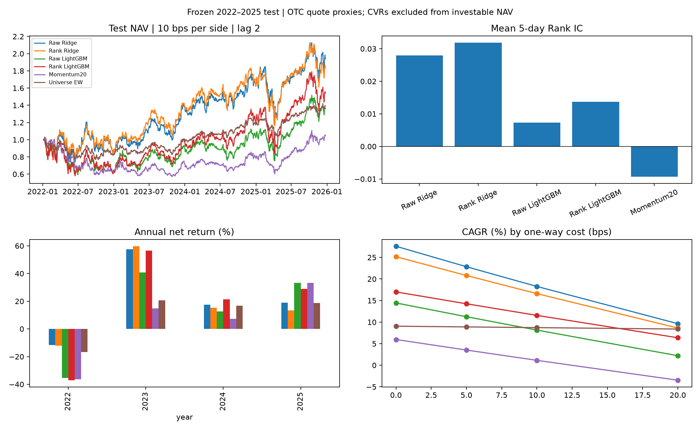

# Cross-sectional Equity ML Research

用美股历史股票池比较 Ridge、LightGBM 与动量基线，研究机器学习的排序能力能否转化为扣除交易成本后的组合收益。实现覆盖数据审计、因果特征、时间隔离、模型比较、公司行动和应收应付账本。

**最终测试已完成。** 验证期选出的排名 LightGBM 在测试期落后于 Ridge；其相对等权股票池的收益优势也没有得到区块置信区间的支持。项目保留这一结果，没有根据测试期表现重新选模。

## 研究设计

| 环节 | 最终口径 |
|---|---|
| 数据 | WRDS / CRSP CIZ 日频数据；2014 年用于历史窗口 |
| 股票池 | 每月按历史可用信息筛选，最多 500 只美国普通股；价格至少 $5、至少 252 个有效历史观察日，按过去 60 个交易日成交金额排序，每家公司保留一个股份类别 |
| 特征 | 21 个价量特征，覆盖动量、反转、波动率、流动性、市值和市场 beta |
| 标签 | 信号日 t 后，从 t+1 收盘到 t+6 收盘的股票总收益，减同期 CRSP 市场收益 |
| 四组模型 | 原始特征 / 当期横截面排名特征 × Ridge / LightGBM |
| 开发 | 2015–2019 训练，2020–2021 验证选参；每组 20 个配置，共 80 次候选拟合 |
| 最终拟合 | 冻结参数后，使用截至 2021 年末的合格样本拟合四次；标签结束日期不得跨入测试期 |
| 最终测试 | 2022–2025；预先指定排名 LightGBM 为主模型，其他模型为对照 |
| 组合 | 每 5 个交易日发出信号，下一交易日收盘执行，选前 10% 等权持有；不加杠杆 |
| 成本与资金 | 买卖各收 10 bps，另做成本敏感性；普通卖款成交后可用于买入，结算仍通过应收应付账本跟踪，使用历史 T+2 / T+1 日历 |
| 评价 | 信号日横截面 Spearman Rank IC、净 CAGR、Sharpe、最大回撤、换手、覆盖率和配对区块 bootstrap |

训练数据拟合截尾、填补与标准化参数；横截面排名只使用当时可预测的股票。跨分割边界的标签不进入相应训练或评价样本。股票池使用当前 CRSP 数据版本中的历史有效记录，不能等同于未经事后修订的原始历史数据。

## 测试期结果

主成本情景：单边 10 bps，公司行动采用 `lag_2` 到账情景。Sharpe 使用零无风险利率假设。

| 策略 | 净 CAGR | Sharpe | 最大回撤 | 平均 Rank IC |
|---|---:|---:|---:|---:|
| 原始特征 Ridge | 18.27% | 0.617 | -36.69% | 0.0280 |
| 排名特征 Ridge | 16.60% | 0.593 | -36.60% | 0.0319 |
| 原始特征 LightGBM | 8.15% | 0.395 | -41.93% | 0.0073 |
| **排名特征 LightGBM（预定主模型）** | **11.56%** | **0.469** | **-43.25%** | **0.0137** |
| 20 日动量 | 1.14% | 0.177 | -44.27% | -0.0093 |
| 股票池等权 | 8.72% | 0.504 | -24.22% | — |



排名 LightGBM 相对等权的 CAGR 差为 +2.84 个百分点，但 20 日区块 bootstrap 的 95% 区间为 **[-17.65, +36.10] 个百分点**，不能据此认定存在稳定超额收益。Ridge 的测试期点估计更好，也不能追溯地将其改称预先选定的最佳策略。

重要限制：三笔银行退市使用首个退市后报价模拟强制卖出，期间冻结估值；三笔不可交易 CVR 单独登记但不计入可投资净值。这些是明确披露的记账简化，并非已经核实的实际成交。交易成本为统一费率假设，没有完整模拟冲击成本和成交容量。

汇总文件见 [results](results/README.md)。个股行情、预测、持仓和模型文件不包含在公开仓库。

## 快速运行：不需要 WRDS

Python 3.11。在仓库根目录运行：

```powershell
python -m venv .venv
.\.venv\Scripts\Activate.ps1
python -m pip install -r requirements.txt
python scripts/check_environment.py
python -m pytest -q
```

Linux/macOS 使用 `source .venv/bin/activate`。环境检查只用合成数据；测试覆盖特征因果性、标签边界、预处理隔离、资金结算、公司行动和账本核对，不会训练真实策略或读取真实测试期行情。GitHub Actions 配置使用同一测试入口。

`requirements.txt` 是直接依赖；`requirements.lock.txt` 记录原研究的本地环境，不作为跨平台安装入口。

## 六个运行入口

入口只解析阶段、调用模块；计算实现集中在 `src/equity_research/`。

| 入口 | 阶段参数 | 用途 |
|---|---|---|
| `scripts/check_environment.py` | 无 | 合成数据环境检查 |
| `scripts/prepare_data.py` | `ingest / universe / audit / returns / features / validate / validation-events / test-audit / test-events` | 数据准备与公司行动审计 |
| `scripts/train_models.py` | `select / final-fit` | 开发期选参、冻结后的四次拟合 |
| `scripts/backtest.py` | `validation / test` | 现有预测的组合回测 |
| `scripts/evaluate.py` | `test / validation-exposures` | 结果评价与暴露分析 |
| `scripts/verify.py` | `features / selection / final-models / history` | 独立核验与本地历史快照校验 |

例如，`python scripts/prepare_data.py --help` 查看参数，`python scripts/verify.py history` 核验本地历史记录。查看帮助不会读取行情或启动训练。

这些入口表示研究阶段，**不是一条可直接从干净克隆顺序执行的命令链**。完整研究依赖授权数据、已核实的公司行动资料以及本地冻结清单。部分入口主动拒绝覆盖已有运行。公开仓库可直接运行合成测试；原研究的全部数值复现还需要上述本地输入和历史产物。

建议按 `data/universe.py` → `data/features.py` → `models/preprocessing.py` → `models/selection.py` → `backtest/engine.py` → `evaluation/frozen.py` 阅读。最终选参使用完整训练期和验证集；三折训练入口已移除。

验证期和测试期共用交易引擎、结算日期算法与应收应付账本，显式传入各自已核验的日历。`tests/reference/` 保留少量旧算法作为独立回归对照，生产模块不依赖它们。

```text
scripts/                   六个运行入口
src/equity_research/
  data/                    数据审计、历史股票池、特征标签与公司行动
  models/                  预处理、选参、最终拟合与核验
  backtest/                交易引擎、共享账本、日历与运行流程
  evaluation/              分组统计、暴露和最终评价
  paths.py                 统一项目路径
  provenance.py            当前文件与历史快照的哈希核验
config/                    研究参数与公开结算日历
tests/                     合成数据、隔离与新旧引擎回归测试
docs/                      研究规则与历史方案
results/                   组合级汇总与图
.github/                   自动化测试配置
data/ outputs/             本地数据与研究产物（Git 忽略）
reports/ archive/          本地历史报告与源码快照（Git 忽略）
```

## 数据与复现边界

取得自己的 WRDS / CRSP 使用权限后，参考 [查询配置示例](config/crsp_query.example.json) 准备本地 `config/crsp_query.json`。实际下载文件、行数和 SHA256 需与自己的提取结果一致；不能复用其他提取的哈希。该本地配置包含下载来源信息，因此不提交 Git。

研究规则详见 [原始设计及修订](docs/RESEARCH_DESIGN.md)、[数据口径](docs/DATA_CONVENTIONS.md)、[特征与标签](docs/FEATURES_AND_LABELS.md)、[完整训练期选参](docs/FULL_TRAIN_SELECTION_PROTOCOL.md)、[最终资金规则](docs/FINAL_FUNDING_BACKTEST_PROTOCOL.md) 和 [冻结测试方案](docs/FINAL_TEST_PROTOCOL.md)。早期文档及配置中的旧命令和“尚未测试”等状态记录的是当时的流程；当前命令以本 README 为准。

本次重构没有重训、选参或改写历史收益。历史清单中的旧源码路径使用本地 `archive/github_cleanup_20261019/snapshot/` 校验原始字节；当前 `src/`、配置、数据和模型始终检查当前文件，不使用快照替代。历史源码哈希证明的是原运行版本，当前实现另由新旧引擎数值对照测试验证。

本地快照不随仓库分发，因此干净克隆可以运行合成测试，但不能独立完成历史运行的全部溯源核验。原始 CRSP 数据不公开，数据访问和使用受各自授权条款约束。
