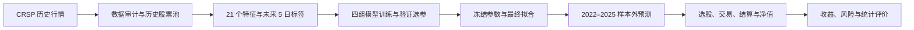

# 美股横截面机器学习选股研究

**Cross-sectional Equity ML Research · Python / Ridge / LightGBM / Event-driven Backtesting**

研究一个具体问题：**利用股票过去的价格与成交量，能否预测未来一周的相对表现，并将预测转化为扣除交易成本后的组合收益？**

项目基于 WRDS / CRSP 美股日频数据，构建历史股票池和 21 个价量特征，对比 Ridge、LightGBM、动量与等权基准，完成从数据审计、模型训练到交易回测和样本外评价的完整研究流程。最终测试覆盖 **2022–2025 年**。

测试中，原始特征 Ridge 的扣费年化收益为 **18.27%**，股票池等权基准为 **8.72%**；验证期选出的主模型“排名特征 LightGBM”为 **11.56%**。模型在验证期与测试期的排序发生变化，是本项目关于泛化能力的主要发现。

[查看测试结果](#测试结果与研究发现) · [阅读核心代码](docs/diagrams/READING_PATH.md) · [查看可编辑导图](docs/diagrams/README.md) · [运行测试](#快速运行)

## 项目概览

| 项目要素 | 内容 |
|---|---|
| 研究任务 | 预测同一时点不同股票未来 5 个交易日的超额收益，并据此选股 |
| 研究范围 | 美国普通股；每月动态筛选最多 500 只股票 |
| 数据跨度 | 2014–2025 年；2014 年用于历史窗口预热 |
| 模型比较 | 原始特征 / 横截面排名特征 × Ridge / LightGBM，共四组 |
| 交易方式 | 只做多、不加杠杆，每 5 个交易日产生信号，下一交易日收盘调仓 |
| 评价层次 | 预测排序能力 → 扣费组合收益 → 风险暴露与统计不确定性 |
| 工程交付 | 模块化 Python 代码、6 个命令入口、184 项自动化测试、研究协议和结果汇总 |
| 技术栈 | pandas、NumPy、SciPy、scikit-learn、LightGBM、PyArrow、Matplotlib、pytest |

项目中的主要工作包括：

- **数据处理：**审计收益、复权与退市字段，按历史信息构建股票池，处理缺失值、异常收益和公司行动。
- **机器学习：**设计价量特征与未来收益标签，在时间隔离下比较线性模型与树模型，并控制选参预算。
- **交易建模：**将预测转换为持仓，逐日计算交易成本、应收应付、结算与净值，核对资金守恒。
- **研究分析：**结合 Rank IC、收益回撤、分组表现、风格与行业暴露、区块置信区间解释结果。

## 研究思路



### 1. 先定义每个时点可以买哪些股票

每个月末使用当时的价格、历史长度和流动性信息构建股票池，供下一月使用。筛选美国普通股，要求价格至少 **5 美元**、至少 **252 个有效历史观察日**；过去 60 个交易日中至少有 50 个有效成交金额观察，按该窗口的平均成交金额排序。

同一家公司存在多个股份类别时，保留流动性最高的一类，最终最多选择 500 只股票。这样的股票池随时间变化，能够保留后来退市的股票，也能避免用今天的上市公司名单回填历史。

核心实现：[历史股票池](src/equity_research/data/universe.py)。

### 2. 用历史价量解释未来相对收益

21 个特征覆盖以下信息：

| 特征类别 | 捕捉的信息 |
|---|---|
| 动量与反转 | 多个历史窗口的累计收益、跳过近期的动量、短期反转 |
| 波动与价格位置 | 总波动、下行波动、日内振幅、收盘价在当日区间的位置 |
| 成交与流动性 | 成交金额、成交量变化、换手率、Amihud 非流动性 |
| 规模与市场敏感度 | 对数市值、滚动市场 beta |

标签对应实际执行时点：在信号日 `t` 收盘后形成预测，目标为 **`t+1` 收盘到 `t+6` 收盘的股票总收益，减去同期 CRSP 市场收益**。这段持有期包含 5 个交易日收益。

特征使用截至信号日的历史数据；标签单独向未来构造。训练和验证边界处，标签结束日期跨入下一阶段的样本会被排除。

核心实现：[特征与标签](src/equity_research/data/features.py)；完整定义见 [特征说明](docs/FEATURES_AND_LABELS.md)。

### 3. 用四组实验区分特征表示与模型复杂度

| | Ridge：带 L2 正则的线性回归 | LightGBM：梯度提升树 |
|---|---|---|
| 原始特征 | 检验数值型特征的线性关系 | 检验非线性关系与特征交互 |
| 横截面排名特征 | 检验同日相对位置的线性关系 | 检验相对位置上的非线性关系 |

原始特征的截尾阈值、缺失值填补中位数和标准化参数均由训练样本估计。排名特征先在每个信号日的合格股票之间进行排序，再使用训练期拟合的预处理状态。两类模型共享相应的输入处理规则。

最终采用的训练与评价顺序如下：

| 阶段 | 时间 | 用途 |
|---|---|---|
| 开发训练 | 2015–2019 | 拟合预处理与候选模型 |
| 验证选参 | 2020–2021 | 按各信号日等权平均 Rank IC 选择配置 |
| 最终拟合 | 2015–2021 | 固定参数，重新拟合预处理及四组模型；标签截止于 2021 年末 |
| 冻结测试 | 2022–2025 | 评价保存的模型与固定交易规则 |

最终选参轮次为**每组 20 个配置，共 80 次候选拟合**。开发过程中还比较过训练期内部时间交叉验证和 9 / 21 特征方案，最终保留 21 特征及上述训练验证划分。排名 LightGBM 在测试前被指定为主模型，其余三组模型保留为对照。

核心实现：[预处理](src/equity_research/models/preprocessing.py)、[验证选参](src/equity_research/models/selection.py)、[最终拟合](src/equity_research/models/final_fit.py)。

### 4. 把预测转化为可核对的交易过程

四组模型与 20 日动量基线均选取评分最高的前 10% 股票，等权构造目标持仓；等权基准持有整个合格股票池。所有组合使用一致的执行日历、成本和资金规则。

每 5 个交易日形成信号，于下一交易日收盘执行。回测逐日更新持仓价值，先处理公司行动与到期款项，再计算调仓买卖、交易成本和可用购买力。普通卖款成交后可用于买入，实际交收通过应收应付账本跟踪，覆盖历史 **T+2 / T+1** 结算规则。

主要成本假设为买卖各 **10 bps（0.10%）**，另设成本和公司行动到账时间敏感性情景。独立核验会检查现金、持仓、应收应付、费用与净值之间的对应关系。

核心实现：[目标持仓与行情](src/equity_research/backtest/market.py)、[交易引擎](src/equity_research/backtest/engine.py)、[资金账本](src/equity_research/backtest/ledger.py)、[结算日历](src/equity_research/backtest/settlement.py)。

### 5. 同时评价预测能力、收益和风险

**Rank IC** 衡量预测排序与实际收益排序的一致性；**扣费年化收益**衡量资金增长；**Sharpe 和最大回撤**衡量承担的风险。项目同时检查换手率、覆盖率、分组收益和时间稳定性，并在验证期分析市值、波动率、beta、行业暴露与收益贡献。

模型间的比较使用配对区块 Bootstrap：按连续时间区块重采样，保留部分时间依赖，为 IC 差和收益差估计置信区间。

核心实现：[测试评价](src/equity_research/evaluation/frozen.py)、[分组诊断](src/equity_research/evaluation/groups.py)、[暴露分析](src/equity_research/evaluation/exposures.py)。

## 测试结果与研究发现

以下为 **2022–2025 年**测试结果，采用单边 10 bps 成本及公司行动 `lag_2` 到账情景。年化收益已扣费；Sharpe 使用零无风险利率。

| 组合 | 净年化收益 | Sharpe | 最大回撤 | 平均 Rank IC |
|---|---:|---:|---:|---:|
| 原始特征 Ridge | **18.27%** | **0.617** | −36.69% | 0.0280 |
| 排名特征 Ridge | 16.60% | 0.593 | −36.60% | **0.0319** |
| 原始特征 LightGBM | 8.15% | 0.395 | −41.93% | 0.0073 |
| **排名特征 LightGBM（预定主模型）** | **11.56%** | **0.469** | **−43.25%** | **0.0137** |
| 20 日动量 | 1.14% | 0.177 | −44.27% | −0.0093 |
| 股票池等权 | 8.72% | 0.504 | **−24.22%** | — |


**Ridge 在本次样本外比较中表现更好。**原始 Ridge 的收益和 Sharpe 最高，排名 Ridge 的排序相关性最高。排名 LightGBM 相对排名 Ridge 的平均 Rank IC 差为 −0.0181，10 个信号日期区块的配对 Bootstrap 95% 区间为 [−0.0325, −0.0035]。

**2022 年的亏损差异对累计结果影响很大。**原始 Ridge 当年收益为 −11.73%，排名 LightGBM 为 −37.06%。排名 LightGBM 在 2024、2025 年分别取得 21.25%、28.91% 的收益，整体年化收益仍低于两组 Ridge。这体现了跨年份稳定性对复利结果的重要性；模型差异的因果解释还需要进一步实验。

**主模型的收益提升伴随着更大的风险。**排名 LightGBM 相对等权基准的年化收益高 2.84 个百分点，最大回撤为 −43.25%，等权为 −24.22%。其年化收益差的 20 日区块 Bootstrap 95% 区间为 [−17.65, +36.10] 个百分点，现有证据尚不足以确认稳定超额收益。

研究结论是：在这组价量特征与固定交易规则下，验证期的模型优势没有延续为相同的测试期排序；线性正则化模型提供了有竞争力的样本外对照。模型选择需要同时考虑时间泛化、组合风险和收益差的不确定性。

结果文件：[整体指标](results/summary.csv) · [逐年收益](results/annual_metrics.csv) · [逐年 Rank IC](results/annual_rank_ic.csv) · [配对置信区间](results/paired_confidence_intervals.csv)。逐年收益文件包含多个情景，比较时筛选 `scenario=lag_2`、`cost_bps=10`。

## 代码结构与阅读路线

```text
scripts/                   6 个命令入口
src/equity_research/
  data/                    导入、审计、历史股票池、特征标签与公司行动
  models/                  预处理、选参、最终拟合与独立核验
  backtest/                目标持仓、交易引擎、资金账本和结算日历
  evaluation/              分组诊断、风险暴露和测试评价
  paths.py                 项目路径
  provenance.py            文件与历史快照的哈希核验
config/                    研究参数、公司行动规则与结算日历
tests/                     合成数据测试与独立回归对照
docs/                      研究协议、代码导图和阅读路线
results/                   组合级结果与图表
.github/workflows/         GitHub Actions 自动化测试
```

建议先按五个模块阅读：**历史股票池 → 特征与标签 → 模型与训练 → 组合与回测 → 评价与解释**。每个模块的核心函数和辅助实现已分层整理在 [代码阅读路线](docs/diagrams/READING_PATH.md)；[可编辑导图](docs/diagrams/README.md)提供七页模块地图与函数索引。

验证期和测试期共用交易引擎与资金账本，并传入各阶段的结算日历。`tests/reference/` 保存独立参考实现，用于检查重构前后计算结果的一致性。

## 快速运行

使用 **Python 3.11**。在仓库根目录执行以下命令即可检查环境并运行合成数据测试，无需 WRDS 账户：

```powershell
python -m venv .venv
.\.venv\Scripts\Activate.ps1
python -m pip install -r requirements.txt
python scripts/check_environment.py
python -m pytest -q
```

Linux / macOS 激活环境使用 `source .venv/bin/activate`。当前测试套件包含 **184 项测试**，覆盖特征因果性、标签边界、预处理隔离、公司行动、资金结算与净值核对。GitHub Actions 使用同一测试入口。

`requirements.txt` 定义安装依赖；`requirements.lock.txt` 保存原研究的本地环境版本。

<details>
<summary>完整研究的命令入口与数据准备</summary>

| 入口 | 阶段参数 | 用途 |
|---|---|---|
| `scripts/check_environment.py` | 无 | 合成数据环境检查 |
| `scripts/prepare_data.py` | `ingest / universe / audit / returns / features / validate / validation-events / test-audit / test-events` | 数据准备、特征与事件审计 |
| `scripts/train_models.py` | `select / final-fit` | 验证选参、冻结后的最终拟合 |
| `scripts/backtest.py` | `validation / test` | 验证期或测试期组合回测 |
| `scripts/evaluate.py` | `test / validation-exposures` | 测试评价与验证期暴露分析 |
| `scripts/verify.py` | `features / selection / final-models / history` | 独立核验与历史溯源 |

通过 `python scripts/prepare_data.py --help` 等命令查看各入口参数。

完整数值复现需要自有 WRDS / CRSP 权限、授权行情、已核实的公司行动资料，以及各阶段的冻结清单和本地产物。取得数据后，参考 [查询配置示例](config/crsp_query.example.json) 创建本地 `config/crsp_query.json`，填写本次提取的文件、行数和 SHA256。

入口按研究阶段组织，各阶段需要相应上游产物；部分入口会拒绝覆盖已经完成的运行。公开仓库直接支持环境检查与合成测试，历史运行溯源另需本地源码快照。原始行情、个股预测、持仓、模型、下载配置和历史快照通过 `.gitignore` 保留在本地。

历史源码哈希核对原运行版本，当前实现通过独立参考算法与回归测试核验。早期协议记录当时的方案与状态，当前入口和已完成状态以本 README 为准。

</details>

## 研究假设与适用范围

- **数据版本：**股票池依据当前 CRSP 数据版本中的历史有效记录构建；供应商后续修订仍可能影响历史数据。
- **选模过程：**验证期用于多轮开发与诊断，最终选参轮次固定为 80 次拟合；冻结测试保留预定主模型与全部对照结果。
- **退市处理：**三笔银行退市在首个退市后报价出现前冻结估值，并按该报价模拟强制卖出；三笔不可交易的或有价值权利（CVR）单独登记，排除于可投资净值之外。
- **执行假设：**交易成本采用统一费率；市场冲击、成交容量与真实订单执行需要进一步建模。

这些假设规定了结果的解释范围。后续研究可围绕滚动训练、风险约束与容量建模提出新实验，并使用新增样本评估改进效果。

## 研究文档

[研究设计](docs/RESEARCH_DESIGN.md) · [数据口径](docs/DATA_CONVENTIONS.md) · [特征与标签](docs/FEATURES_AND_LABELS.md) · [最终选参方案](docs/FULL_TRAIN_SELECTION_PROTOCOL.md) · [资金与结算规则](docs/FINAL_FUNDING_BACKTEST_PROTOCOL.md) · [冻结测试方案](docs/FINAL_TEST_PROTOCOL.md)
