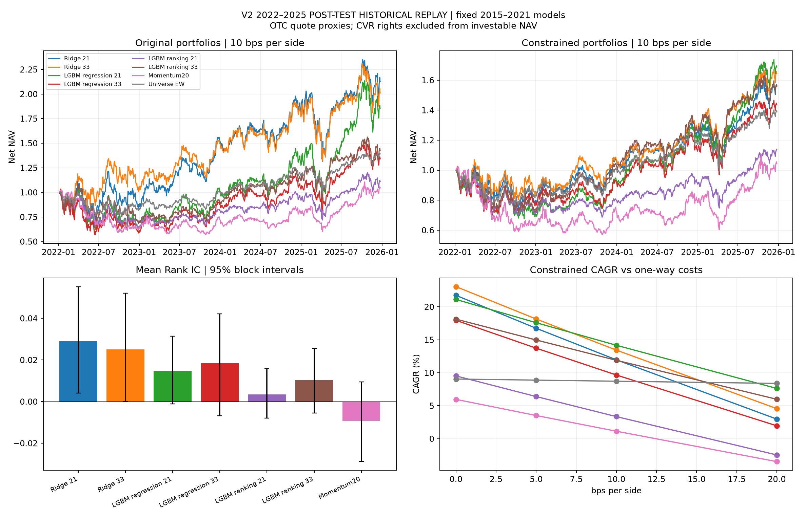

# 美股横截面机器学习选股研究

**Cross-sectional Equity ML Research · Python · Ridge / LightGBM · Event-driven Backtesting**

**历史价量信息能否预测股票未来一周的相对表现，并在交易成本与风险约束下转化为组合收益？**

本项目基于 WRDS/CRSP 美股日频数据，完成历史股票池、特征标签、模型比较、交易结算和统计评价的完整研究流程。V1 检验线性模型与树模型的时间泛化；V2 进一步检验风险约束、市场与行业背景特征、排序目标的增量。

主要发现是：**验证期的模型优势没有稳定延续；风险约束降低了波动和回撤，也牺牲了部分收益；增加特征或模型复杂度，没有形成一致的扣费收益优势。**

[一页研究结论](docs/RESEARCH_CONCLUSIONS.md) · [V1 测试结果](results/README.md) · [V2 历史评价](results/historical_replay_v2/README.md) · [快速运行](#快速运行) · [代码阅读路线](docs/diagrams/READING_PATH.md)

## 研究思路


| 研究环节 | 实现与判断依据 |
|---|---|
| 历史股票池 | 按上月末可用信息筛选美国普通股，检查价格、历史长度和流动性，同公司股份去重，每月最多 500 只；保留后来退市的股票 |
| 特征与标签 | 21 个动量、反转、波动、流动性、市值及 beta 特征；V2 增加 12 个市场/行业背景特征。标签为 `t+1` 收盘至 `t+6` 收盘的股票总收益减同期市场收益 |
| 信息隔离 | 特征仅使用截至信号日的信息；同日排名先于未来标签资格筛选；截尾、填补和标准化只在训练样本上拟合；排除跨阶段标签 |
| 交易规则 | 只做多、不加杠杆，每五个交易日发出信号，下一交易日收盘调仓；前 10% 等权与风险约束组合，对照正向 20 日动量和股票池等权 |
| 执行与评价 | 主成本为买卖各 10 bps；逐日处理公司行动、应收应付与历史 T+2/T+1 结算。联合考察 Rank IC、扣费收益、回撤、换手、暴露和配对区块 Bootstrap 区间 |

### 两版实验如何衔接

| | V1：建立模型与交易基线 | V2：检验改进的增量 |
|---|---|---|
| 模型设计 | 原值／横截面排名 × Ridge／LightGBM 回归，四组 | 21／33 特征 × Ridge 回归、LightGBM 回归／排序，六组 |
| 开发窗口 | 2015–2019 训练，2020–2021 验证选参 | 2015–2018→2019、2015–2019→2020–2021，两窗口等权平均 Rank IC 选参 |
| 拟合预算 | 正式选参轮次 80 次候选拟合，随后四次最终拟合 | 48 次候选拟合，随后六次最终拟合 |
| 冻结主模型 | 排名特征 LightGBM | 增强特征 Ridge；增强排序 LightGBM 为挑战模型 |
| 2022–2025 的用途 | 模型冻结后测试 | **已见数据上的事后历史稳健性回放** |

两版最终拟合均使用 2015–2021 的 **175,334 条合格样本**，最大训练标签终点为 2021-12-30，评价期间保持模型不变。V2 的 Ridge 使用原值；树模型的原有 21 维使用横截面排名，新增 12 维保留原值背景信息。

V1 开发期还经历过其他探索，80 次并非全项目累计拟合数。完整过程和各版本身份见[实验总索引](docs/EXPERIMENT_INDEX.md)；V2 的预算、主要比较和新留出期边界见[冻结评价方案](docs/FINAL_EVALUATION_V2.md)。

## 主要发现

以下 CAGR 均为**扣费年化复合收益率**，采用买卖各 **10 bps（0.10%）**、公司行动 `lag_2` 口径。`lag_2` 表示公司行动对价的可用时间情景，普通交易交收另按历史 T+2/T+1 日历处理。

### V1：验证期最优模型未保持测试期领先

| 组合 | 净 CAGR | 最大回撤 | 平均 Rank IC |
|---|---:|---:|---:|
| 原始特征 Ridge | **18.27%** | −36.69% | 0.0280 |
| 排名特征 Ridge | 16.60% | −36.60% | **0.0319** |
| 原始特征 LightGBM | 8.15% | −41.93% | 0.0073 |
| **排名特征 LightGBM（预定主模型）** | **11.56%** | **−43.25%** | **0.0137** |
| 20 日动量 | 1.14% | −44.27% | −0.0093 |
| 股票池等权 | 8.72% | **−24.22%** | — |

Ridge 在这次测试中提供了更好的收益与排序对照；主模型仍保留为测试前指定的排名 LightGBM。其 CAGR 高于等权，最大回撤也明显更深，说明收益比较必须同时考虑风险承担。

数据来源：[正式指标](results/summary.csv) · [测试图表](results/test_overview.png) · [风险暴露与 2022 年归因](results/test_diagnostics/README.md)。

### V2：风险控制有效，模型增量具有条件依赖性

V2 复用相同执行与资金规则，比较六组模型的前 10% 等权组合和风险约束组合。约束针对目标持仓：单股权重上限 2%、行业主动权重 ±2%、beta 主动暴露 ±0.1，个股年化波动率加权均值不超过等权基准加 0.1。最后一项并非组合波动率目标。

| 模型 | 前 10% 等权 CAGR | 风险约束 CAGR | 风险约束最大回撤 |
|---|---:|---:|---:|
| Ridge：21 特征 | **21.01%** | 11.97% | −28.89% |
| **Ridge：33 特征（冻结主模型）** | **19.34%** | **13.44%** | **−24.75%** |
| LightGBM 回归：21 特征 | 16.96% | **14.17%** | −32.55% |
| LightGBM 回归：33 特征 | 7.70% | 9.67% | −33.01% |
| LightGBM 排序：21 特征 | 2.75% | 3.36% | −32.00% |
| LightGBM 排序：33 特征 | 9.45% | 11.89% | −29.69% |

同口径动量和等权基准的 CAGR 分别为 **1.14%**、**8.72%**。V2 的 21 特征 Ridge 是重新选定参数并最终拟合的模型，与 V1 原始 Ridge 是不同模型文件。

- **风险降低伴随收益取舍。** V2 原有 Ridge 加约束后，年化波动由 40.52% 降至 26.30%，最大回撤由 −37.03% 改善至 −28.89%；CAGR 由 21.01% 降至 11.97%。
- **主要收益增量尚不确定。** 增强 Ridge 减原有 Ridge，在约束组合中的年化平均日净收益差为 **+1.21 个百分点**，95% 配对区块区间为 **[−4.37，+6.78] 个百分点**，包含零。该统计量是日收益差均值乘 252，与 CAGR 差不同。
- **复杂度没有带来一致优势。** 增强树回归落后于原有特征回归；增强排序改善了部分结果，但没有延续开发期的领先表现。树模型各组叶数不同，这些差异对应完整方案，不能全部归因于某一项特征或目标函数。
- **换手和成本仍是薄弱环节。** 增强 Ridge 的约束 CAGR 在单边 0／10／20 bps 下分别为 23.07%／13.44%／4.57%；20 bps 时，六组约束模型均低于等权基准的 8.39%。



V2 已完成 56 条组合路径与 13,958 个主组合日期的独立账本核验，原有结果完整保留。2022–2025 已被用于此前研究，本轮属于事后评价；新增未见数据尚未读取。详见[统一结果、年度表现与区间](results/historical_replay_v2/README.md)。

## 项目亮点

- **把数据口径落实到交易账本。** 审计复权、异常收益和退市记录，区分供应商收益、现金对价、换股及实际可用资金，逐日核对持仓、应收应付、费用与净值。
- **保留完整的实验比较。** 明确时间窗口、拟合预算、主要模型与比较指标，保存参数、预处理和模型哈希；不利结果与历史探索均可追溯。
- **将预测评价与投资组合评价分开。** 同时检查排序相关性、顶部选股、覆盖率、风险暴露和成本，解释为什么 IC 改善未必对应净收益提升。
- **提供可运行、可检查的工程交付。** 模块化 Python 实现、无需账户的合成演示、独立参考算法及自动化测试；GitHub Actions 配置覆盖公开测试入口。

技术栈：**pandas · NumPy · SciPy · scikit-learn · LightGBM · PyArrow · Matplotlib · pytest**。

## 快速运行

### 无需 WRDS：运行核心流程演示

使用 **Python 3.11**。Windows PowerShell：

```powershell
git clone https://github.com/ZhiyiShao/cross-sectional-equity-ml.git
cd cross-sectional-equity-ml
python -m venv .venv
.\.venv\Scripts\Activate.ps1
python -m pip install -r requirements.txt
python scripts/check_environment.py --demo
```

Linux／macOS 将激活命令替换为 `source .venv/bin/activate`，其余步骤相同。

演示生成 60 只虚构证券，调用核心代码完成历史股票池、21 个特征与标签、四组模型训练、预测、六组组合回测及账本核验。**这是 V1 核心流程的合成演示，收益不代表真实策略表现，也不复现 V2 的六设计实验。**

输出位于 `outputs/demo/`，先查看 `demo_overview.png` 和 `summary.csv`。再次运行可用 `--output outputs/demo_run2` 指定新的空目录；已有结果不会被覆盖。详细输入、步骤与文件见[演示说明](docs/DEMO.md)。

```bash
# 自动化测试（包含合成演示；本地历史产物检查按可用性跳过）
python -m pytest -q
```

依赖范围见 [requirements.txt](requirements.txt)，原研究环境版本见 [requirements.lock.txt](requirements.lock.txt)。

### 有授权数据：正式研究入口

正式数值复现需要 WRDS/CRSP 权限、授权行情、已核验的公司行动资料及阶段产物。原始行情、个股预测、持仓和模型权重留在本地；仓库公开代码、配置、合成演示和聚合结果。

| 工作 | 入口与说明 |
|---|---|
| 数据准备 | `python scripts/prepare_data.py --help`；参见[查询配置示例](config/crsp_query.example.json)与[数据口径](docs/DATA_CONVENTIONS.md) |
| 模型开发与最终拟合 | `scripts/train_models.py`；V1/V2 阶段及产物依赖见[实验总索引](docs/EXPERIMENT_INDEX.md) |
| V2 模型包检查 | `python scripts/evaluate.py v2-preflight`；仅核对已有模型、配置及哈希 |
| V2 历史回放 | `python scripts/backtest.py historical-v2`；需六个最终模型和历史审计产物，已完成目录会拒绝重跑 |
| 独立模型核验 | `python scripts/verify.py final-models-v2`；重算与加载检查，不重新拟合模型 |

各入口的 `--help` 可查看当前参数。历史协议记录原实验时点的状态；已完成阶段与输出位置以[实验总索引](docs/EXPERIMENT_INDEX.md)为准。

## 核心代码

| 阅读顺序 | 主要实现 |
|---|---|
| 历史股票池 | [data/universe.py](src/equity_research/data/universe.py) |
| 特征与标签 | [data/features.py](src/equity_research/data/features.py) |
| 预处理与训练 | [models/preprocessing.py](src/equity_research/models/preprocessing.py)、[V1 选参](src/equity_research/models/selection.py)、[V2 背景特征](src/equity_research/models/context_selection.py)、[排序模型](src/equity_research/models/ranking_selection.py)、[V2 最终拟合](src/equity_research/models/final_fit_v2.py) |
| 组合与交易 | [backtest/market.py](src/equity_research/backtest/market.py)、[engine.py](src/equity_research/backtest/engine.py)、[ledger.py](src/equity_research/backtest/ledger.py)、[V2 回放](src/equity_research/backtest/replay_v2.py) |
| 评价与解释 | [V1 评价](src/equity_research/evaluation/frozen.py)、[V2 评价入口](src/equity_research/evaluation/v2.py)、[V2 诊断](src/equity_research/evaluation/replay_v2.py) |

完整函数路线与辅助实现见[核心精读／辅助查阅](docs/diagrams/READING_PATH.md)和[可编辑导图](docs/diagrams/README.md)。`tests/reference/` 保存独立参考算法，`config/` 保存研究与执行规则，`results/` 保存公开聚合结果。

## 结果的解释范围

研究覆盖单一市场和有限年份，固定到 2021 年的模型存在时间老化；开发期经过多轮探索，V2 需要新的未见数据形成进一步证据。历史股票池使用当前供应商版本中的历史有效记录，仍受数据修订影响。

交易成本采用固定费率，尚未估计容量与非线性市场冲击；风险限制作用于目标持仓，费用、成交限制和公司行动会造成实际暴露偏离。三笔银行退市采用首个退市后报价强制处置代理，三笔不可交易 CVR 单独登记并排除于可投资净值，这些口径随结果一起披露。

历史交叉验证、9／21 特征比较、事件记账修订及各轮诊断均保留在[实验总索引](docs/EXPERIMENT_INDEX.md)。研究主线与证据摘要见[一页研究结论](docs/RESEARCH_CONCLUSIONS.md)。
