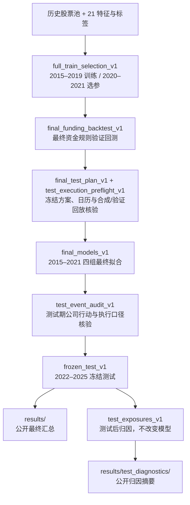

# 实验总索引

**当前正式结果：21 个特征、四组模型、完整 2015–2019 训练并在 2020–2021 选参，随后固定参数、用 2015–2021 合格样本最终拟合，完成 2022–2025 冻结测试。** 排名 LightGBM 是测试前指定的主模型；两组 Ridge 和原始 LightGBM 是对照。三折交叉验证、9 特征比较属于历史探索。

| 想了解什么 | 从哪里开始 |
|---|---|
| 最终表现和统计不确定性 | [六组组合结果](../results/README.md)、[汇总指标](../results/summary.csv)、[配对置信区间](../results/paired_confidence_intervals.csv) |
| 为什么测试期 Ridge 更好 | [风险暴露与 2022 年持仓归因](../results/test_diagnostics/README.md) |
| 如何不使用 WRDS 跑通流程 | [完整合成演示](DEMO.md) |
| 如何读代码 | [五模块阅读路线](diagrams/READING_PATH.md) |

本文是研究状态与实验关系的导航，不参与程序执行。`outputs/`、`data/`、`reports/`、`archive/` 为本地产物，未随 GitHub 发布；以下用代码格式标明这些路径，避免把本地记录伪装成可下载链接。公开的代码、配置、协议和组合汇总使用可点击链接。

## 当前正式方案

| 阶段 | 数据与规则 | 权威记录 |
|---|---|---|
| 数据与股票池 | CRSP CIZ；2014 预热；历史月度股票池最多 500 只；21 个价量特征；严格未来 5 日超额收益标签 | [股票池配置](../config/universe.json)、[特征配置](../config/features_labels.json)、[数据口径](DATA_CONVENTIONS.md) |
| 最终开发选参 | 2015–2019 训练，2020–2021 按逐信号日等权平均 Rank IC 选参；四组各 20 个候选，共 80 次拟合 | [选参配置](../config/full_train_selection.json)、[选参协议](FULL_TRAIN_SELECTION_PROTOCOL.md)；本地 `outputs/full_train_selection_v1/selected.json` |
| 最终验证回测 | 使用上述四组的验证期预测，完成公司行动核验、买卖应收应付与结算账本 | [最终资金协议](FINAL_FUNDING_BACKTEST_PROTOCOL.md)；本地 `outputs/final_funding_backtest_v1/verification.json` |
| 冻结与最终拟合 | 参数固定；2015–2021 共 175,334 个合格样本；4 次最终拟合、2 份预处理状态；实际最大标签终点为 2021-12-30 | [冻结方案](../config/final_test_plan.json)；本地 `outputs/final_models_v1/model_bundle.json`、`readiness.json`、`verification.json` |
| 冻结测试 | 已完成；模型不滚动更新；2022–2025 共 199 个信号日；完整持有期的最终清算日为 2025-12-24 | [测试协议](FINAL_TEST_PROTOCOL.md)、[公开结果](../results/README.md)；本地 `outputs/frozen_test_v1/verification.json` |
| 测试后解释 | 复用保存的预测、持仓与交易，分析风险暴露和 2022 年月度/行业贡献；新增拟合、预测、回测执行均为 0 | [公开归因](../results/test_diagnostics/README.md)；本地 `outputs/test_exposures_v1/audit.json` |

**主结果固定筛选 `scenario=lag_2`、`cost_bps=10`。** `lag_2` 表示公司行动对价的可用时间情景，不是普通交易的 T+2 结算。普通买卖使用历史 T+2 / T+1 日历；已成交卖款可用于买入，同时核验未来交收资金不透支。模型与动量组合选前 10% 等权、每 5 个交易日发信号、下一交易日收盘执行；股票池等权持有全体合格股票。

冻结测试共保存 102 条组合路径：6 组组合 × 4 档费用 × 4 种公司行动到账情景，再加 6 条仅已结算资金的敏感性路径。它们是固定情景比较，不能从中另挑最高收益作为主结果。

### 四组正式模型及文件身份

| 模型 ID | 表示 / 模型 | 冻结的主要参数 | 定位 |
|---|---|---|---|
| `raw__ridge_03` | 原始 / Ridge | `alpha=0.06951927961775606` | 对照；测试期净 CAGR 最高 |
| `cross_sectional_rank__ridge_13` | 排名 / Ridge | `alpha=1128.8378916846884` | 对照；测试期平均 Rank IC 最高 |
| `raw__lightgbm_17` | 原始 / LightGBM | 127 叶、100 棵树、最小叶样本 100 | 对照 |
| `cross_sectional_rank__lightgbm_10` | 排名 / LightGBM | 31 叶、100 棵树、最小叶样本 500 | **测试前指定主模型** |

两组 LightGBM 均使用学习率 0.03、L2 正则 1.0 和随机种子 20261014，其余固定参数见[冻结方案](../config/final_test_plan.json)。预处理只使用相应拟合阶段的合格样本；最终拟合会重新估计预处理，不沿用仅 2015–2019 的统计量。

模型 ID 末尾数字表示该轮候选序号，不是模型版本号。**同一个 ID 在选参目录和最终拟合目录中对应不同的训练日期与模型文件**；历史 CV 的同名候选也不能据名字视作同一个模型。引用模型时应同时写明运行目录与 ID。

## 正式结果从哪里来

箭头表示研究依赖关系，不表示执行图中节点就能自动复现历史运行。完整重现还需要授权数据、已核实事件材料和各阶段产物；部分入口会拒绝覆盖已完成目录。

测试期事件核验中，原规则未覆盖的三笔银行退市与三笔不可交易 CVR，按用户批准的简化规则处理：银行持仓冻结至首个退市后报价日并按该报价模拟强制卖出；CVR 登记数量并排除于可投资净值之外。该执行规则记录于本地 `outputs/test_event_audit_v1/execution_scope.json` 与 `outputs/frozen_test_v1/event_registry.json`。它是最终结果解释范围的一部分，不应省略，也不能当成真实成交核实。

## 历史探索：哪些被保留，哪些已被替代

| 研究分支 | 本地运行目录 | 做了什么 | 与当前结果的关系 |
|---|---|---|---|
| 最初基线 | `outputs/baselines_v1/` | 21 个原始特征，Ridge / LightGBM 各 20 个候选；完整训练期拟合、验证期选参 | 被四组表示 × 模型的最终选参轮次取代；仍是最初诊断依据 |
| 基线诊断 | `outputs/diagnostics_v1/` | 特征逐年 IC、分布变化、极端标签损失、旧参数结果 | 描述性诊断；没有新拟合 |
| 三折时间交叉验证 | `outputs/temporal_cv_v1/` | 在 2015–2019 内，分别以 2017、2018、2019 为内部验证年；22 个配置 × 3 折，共 66 次拟合 | 历史选参分支；**当前主流程已取消三折选参** |
| CV 配置的外部验证 | `outputs/cv_selected_validation_v1/` | 固定内部 CV 选出的四组配置，用 2015–2019 拟合 4 次，在 2020–2021 比较 | 属于 CV 分支的验证结果，不是当前正式四组模型的验证结果 |
| CV 分支的信号诊断 | `outputs/prediction_diagnostics_v1/`、`outputs/validation_signal_diagnostics_v1/` | 配对 IC、分组收益、Q10 区间、换手、时间稳定性与选股重合度 | 使用该阶段既有预测；不应自动套用于后来重新选参的模型 |
| CV 分支的组合验证 | `outputs/validation_backtest_v1/`、`outputs/validation_exposures_v1/` | 旧配置的验证回测与风格/行业暴露 | 保留历史对照；最终资金口径与正式模型结果以后续目录为准 |
| 9 与 21 特征比较 | `outputs/feature_subset_cv_v1/` | 仅在 2015–2019 内比较；9 特征新增 66 次拟合，复用原 21 特征的 66 次 CV 拟合 | **最终仍采用 21 特征**；此实验未查看 2020–2021 验证表现或测试表现 |
| 完整训练期四组选参 | `outputs/full_train_selection_v1/` | 恢复完整 2015–2019 训练；2020–2021 验证选参；四组各 20 个候选 | **当前正式参数的来源** |
| 新参数下的初次验证回测 | `outputs/full_selection_backtest_v1/`、`outputs/full_selection_exposures_v1/` | 使用正式四组验证预测，按当时的退市冻结/释放假设回测并分析暴露 | 模型来源正确，但资金及公司行动规则随后完善；不是最终执行口径 |

三折分支中 Ridge 使用 `alpha = 训练样本数 × lambda`；正式完整训练期选参恢复固定 `alpha` 网格。不能把两轮中的候选序号或正则强度直接等同。详见[历史 CV 协议](TEMPORAL_CV_PROTOCOL.md)与[最终选参协议](FULL_TRAIN_SELECTION_PROTOCOL.md)。

**80 次是最终选参这一轮的预算，不是整个项目累计只拟合了 80 次。** 开发过程中还存在上述基线、内部 CV、特征数量比较与验证再拟合；验证集曾用于多轮开发，不能将最终验证最佳分数视为独立样本外证据。

## 执行规则和公司行动如何收尾

这些步骤主要修正研究的记账与执行定义，保持相应阶段的模型预测不变。

| 本地运行目录 | 核查内容 | 当前定位 |
|---|---|---|
| `outputs/pretest_closeout_v1/` | 验证期重点行业的月度/个股集中度，退市与异常收益复核 | 测试前收尾证据；当时尚有待处理事项 |
| `outputs/lvgo_evidence_v1/` | LVGO 现金与换股终值差异的证据定位 | 历史事件核验；不把供应商终值直接当到账现金 |
| `outputs/corporate_actions_v1/` | 补齐验证期公司行动对价、到账与处置规则 | 后续回测的事件依据 |
| `outputs/corporate_action_backtest_v1/` | 使用核验后的公司行动规则重跑验证期组合 | 后续由显式买卖应收应付账本版本接续 |
| `outputs/final_funding_backtest_v1/` | 最终资金规则、历史结算日历及独立账本核验 | **正式验证期组合结果** |
| `outputs/final_funding_exposures_v1/` | 基于最终资金规则持仓更新 2020、2021 暴露和贡献 | **正式验证期持仓解释** |
| `outputs/final_test_plan_v1/` | 汇总冻结配置与测试前待办 | 保留冻结时点状态；实际后续状态见下一表 |
| `outputs/test_execution_preflight_v1/` | 测试期公开日历、日期隔离、合成数据与验证期回放 | 已完成测试前工程核验，当时未读测试行情 |
| `outputs/final_models_v1/` | 4 个最终模型、2 份预处理、样本边界与重载核验 | **测试实际使用的模型文件** |
| `outputs/test_event_audit_v1/` | 获准进入测试后，按时间核验测试期事件与例外规则 | 冻结测试执行材料 |
| `outputs/frozen_test_v1/` | 保存测试预测、六组组合及敏感性路径、评价和对账结果 | **正式测试结果来源** |
| `outputs/test_exposures_v1/` | 使用既有测试预测和持仓进行风险/收益归因 | **测试后描述性分析**；没有新选参 |

### 如何判断“现在是否已经测试”

| 看到的记录 | 该如何解读 |
|---|---|
| `config/final_test_plan.json` 中 `frozen_plan_not_executed`、授权字段为 `false`、拟合数为 0 | 冻结计划写入时的快照，刻意未被后续执行覆写 |
| `outputs/final_models_v1/fit_summary.json` 中仍写“待独立核验” | 拟合结束时的状态；同目录后续 `verification.json` 为 `passed`，`readiness.json` 确认四组最终模型已核验 |
| `outputs/final_models_v1/readiness.json` 中测试授权仍为 `false` | 最终拟合阶段尚未获准读测试；不代表整个项目永远停在该阶段 |
| `outputs/test_event_audit_v1/execution_scope.json` | 后续测试执行授权与事件核验范围 |
| `outputs/frozen_test_v1/verification.json` 中 `status=completed` | **正式测试已完成**；没有在测试期重新选参 |
| `outputs/test_exposures_v1/audit.json` 中拟合、预测、回测次数均为 0 | 对已完成测试的持仓解释，不是重新执行一次测试 |

旧协议中的“不读取测试集”描述的是相应实验当时的边界。保留这些文件及哈希，便于证明先后顺序；不要批量把旧 `false` 改为 `true`，也不要依据旧状态重新运行已经完成的阶段。

## 演示、失败记录与历史源码

| 路径 | 内容 | 使用方式 |
|---|---|---|
| `outputs/demo/` | 60 只虚构证券、每月最多 40 只；2019 预热、2020 训练、2021 验证、2022 合成留出期；8 次候选拟合 + 4 次最终拟合 | [演示说明](DEMO.md)；仅展示流程，不能与真实测试业绩混用 |
| `outputs/baselines_v1_export_failed/` | 最初基线的导出失败运行，只有部分产物 | 保留排错痕迹，不作为已完成实验或最终结果来源 |
| `archive/github_cleanup_20261019/`、`archive/readability_20261022/` | 本地整理和重构前快照 | 支持旧哈希溯源，不是当前代码入口 |
| [tests/reference/](../tests/reference/) | 公开的独立参考算法 | 用于回归核验，不是待删除的重复生产代码 |

`outputs/` 下各目录的 `v1` 是各自研究任务的首次运行标签，不是同一份模型的连续版本。应先按本索引确定研究问题、模型来源和资金口径，再读取对应结果。

## 引用结果与以后更新

- 对外引用最终测试，从 [results/](../results/README.md) 取数；年度收益文件必须筛选费用与情景。小数 `0.10` 表示 10%，`cost_bps=10` 表示单边 0.10%。
- 解释泛化差异，从 [results/test_diagnostics/](../results/test_diagnostics/README.md) 读取测试后归因；它不改变预定主模型身份，也不建立新的独立验证集。
- [当前命令入口](../README.md#快速运行)用于查看代码如何组织；旧报告中的 `scripts/train_temporal_cv.py` 等历史脚本可能已整理归档，不应按旧文件名盲目执行。
- 以后新增实验，记录目的、数据区间、模型/预测来源、拟合预算、执行口径、输出目录及其与本页正式结果的关系。依据已观察测试结果设计的改动应标为测试后探索，使用新的目录；需要新的未见数据才能形成新的确认性证据。

最初的索引整理没有改写原模型、配置或结果；下列后续实验单独登记。

## 第二版探索：2026-11-07

| 实验 | 数据与来源 | 预算与执行 | 结果 |
|---|---|---|---|
| 风险可比组合回放 | 2020–2021 已有验证预测；2022–2025 已有冻结测试预测；原始 Ridge 与排名 LightGBM | 0 次拟合、0 次新预测；8 条组合路径；固定行业、beta、波动与单股约束；原 10 bps/侧和资金账本 | [汇总](../results/risk_comparison_v2/README.md)；本地 `outputs/risk_comparison_v2/` |
| 第二版模型实验总预算 | 两个固定开发时间窗口 | 六种设计 × 四个候选 × 两个窗口，共 48 次候选拟合已全部使用（第二轮 32、第三轮 16）；另六次最终拟合已完成，剩余预算 0 | [冻结规则](RESEARCH_V2.md) |
| 第二轮背景特征比较 | 2015–2018 → 2019；2015–2019 → 2020–2021；未读取 2022–2025 研究数据 | 四设计 × 四参数 × 两窗口 = 32 次拟合；无最终拟合；保留 16 次给排序；沿用第一轮组合规则回放 2020–2021 | [冻结定义](CONTEXT_FEATURES_V2.md)、[结果](../results/context_selection_v2/README.md)；本地 `outputs/context_selection_v2/` |
| 第三轮排序目标比较 | 相同两个窗口，复用第二轮特征、预处理和回归对照，未读取 2022–2025 研究数据 | 两设计 × 四参数 × 两窗口 = 16 次拟合；无最终拟合；四条新验证组合 | [冻结目标](RANKING_V2.md)、[结果](../results/ranking_selection_v2/README.md)；本地 `outputs/ranking_selection_v2/` |
| 六设计统一结论与后续评价冻结 | 仅第二、三轮现有汇总 | 0 次拟合/预测/回测；六组保留，增强 Ridge 主模型；六次 2015–2021 最终拟合尚未执行；2022–2025 事后评价、2026 未见资格待审计 | [统一比较](../results/v2_comparison/README.md)、[最终方案](FINAL_EVALUATION_V2.md)；本地 `outputs/v2_evaluation_plan/` |
| V2 六组最终拟合与入口核验 | 2015–2021 的 175,334 条合格样本；最大标签终点 2021-12-30 | 6 次最终拟合、3 份共享预处理；独立重算和模型加载预测通过；仅训练期参考预测，无历史回放或新未见数据读取 | [拟合交付与命令](../results/final_models_v2/README.md)；本地 `outputs/final_models_v2/` |
| V2 事后历史稳健性回放 | 已见 2022–2025；199 个完整信号、997 个净值日期 | 0 次拟合/调参；六组各两种组合 + 动量/EW，四档成本共 56 路径；13,958 主组合日账本核验；主要收益差 +1.21pp，95% 区间 [−4.37, +6.78]pp；无新未见数据访问 | [统一结果与解释](../results/historical_replay_v2/README.md)；本地 `outputs/historical_replay_v2/`、`outputs/evaluation_v2_historical_2022/`；入口 `scripts/backtest.py historical-v2` |

第一轮独立复现四条原净值、核对 5,996 个组合日及原产物哈希。`outputs/risk_comparison_v2_invalid_vol_units/` 是年化单位检查发现错误后留存的无效工程运行，不用于研究结论；修正未改变预定约束值。第二版不改变原测试结果或预定主模型身份，已见测试期不再称为未见评价。
