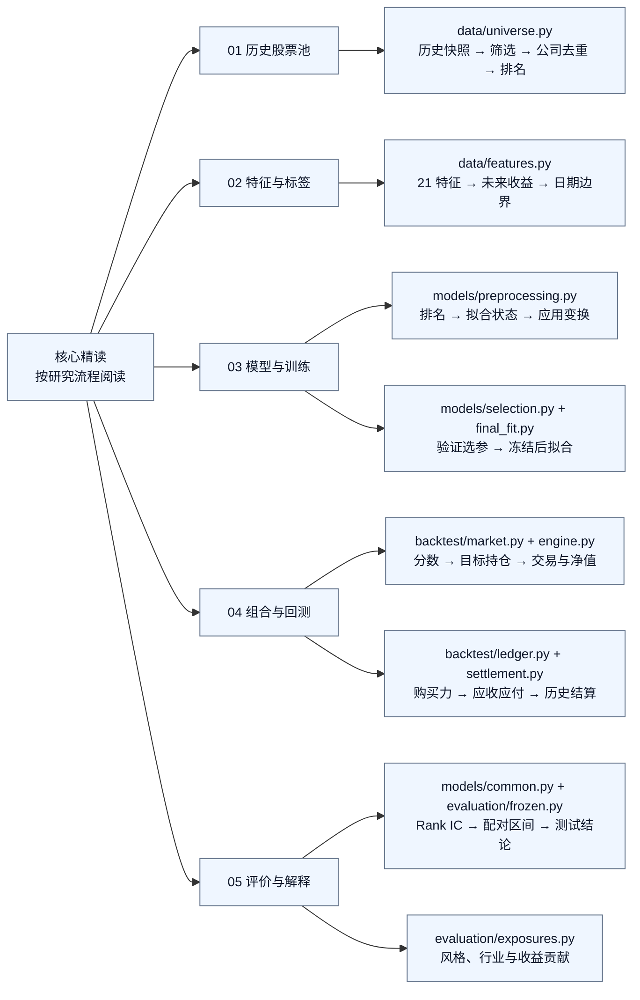
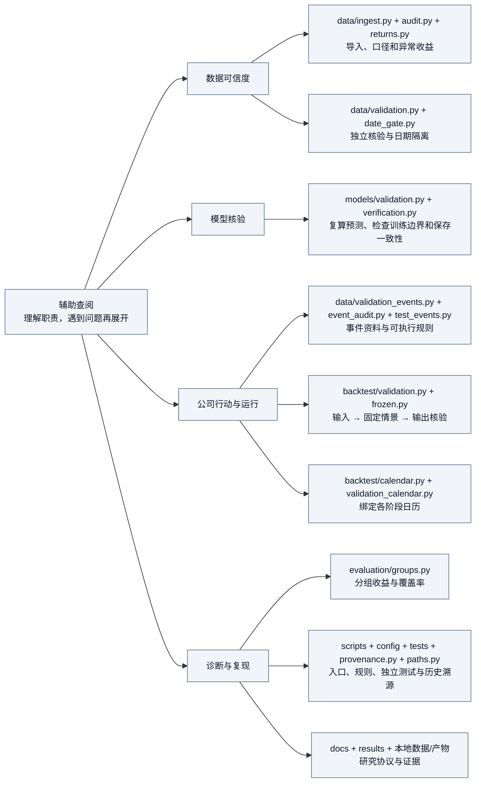

# 两层代码阅读路线

先读核心研究逻辑，辅助实现按问题查阅。完整研究流程和必要核验全部保留。

## 核心精读

### 01 历史股票池
精读 `data/universe.py` 的 `filter_codes()`、`regular_trade()`、`monthly_snapshots()`、`select_month()`。先看筛选规则与信息时间，再看 `build()` 如何串起来。验收：能解释每月为什么选这些股票，以及未来记录为什么不能改变过去股票池。

### 02 特征与标签
精读 `data/features.py` 的 `make_features()`、`compound_past()`、`return_segments()`、`label_one()`、`split_masks()`。验收：能解释特征窗口、t+1 到 t+6 标签、缺失与跨分割边界处理。

### 03 模型与训练
从 `models/preprocessing.py` 读 `cross_sectional_rank()` → `fit_state()` / `fit_preprocessing()` → `transform_features()`。再读 `selection.py` 的候选配置与训练循环，以及 `final_fit.py` 的合格样本边界。数据掩码与模型构造按需查 `common.py`。验收：能解释四组方案、训练期拟合预处理、验证选参和冻结后拟合。

### 04 组合与回测
先读 `market.make_targets()`，再读 `engine.simulate()`；遇到资金约束时进入 `ledger.Ledger`，遇到结算日期时进入 `settlement.SettlementCalendar`，最后看 `engine.verify()`。验收：能解释信号如何变成买卖、现金和净值，为什么标签收益不等于组合收益。

### 05 评价与解释
读 `common.daily_rank_ic()`、`market.performance()` 与 `evaluation/frozen.py` 的配对区间和结果组织；再看 `exposures.py` 的风格、行业与贡献统计。验收：能区分排序能力、扣费收益、风险暴露和统计不确定性。

每轮只精读上述核心函数；输出文件、哈希、绘图等先掌握输入输出即可。核心精读和辅助查阅是学习优先级，运行时仍使用完整流程。

## 辅助查阅

验证期运行组织已拆为 `prepare_inputs()` → `run_scenarios()` → `save_results()`；`main()` 只串联步骤。原始特征预处理已集中到 `models/preprocessing.py`，`models/common.py` 保留兼容导出，原调用方式仍然有效。

完整函数清单见 [导图大纲](README.md)。图中的函数关系表示阅读顺序，不代表完整调用依赖。

旧三折配置与 `tests/reference/cv.py` 属于历史对照；当前选参仍使用 2015–2019 训练、2020–2021 验证。`tests/reference/` 中旧引擎是独立回归对照，不应作为冗余删除。
