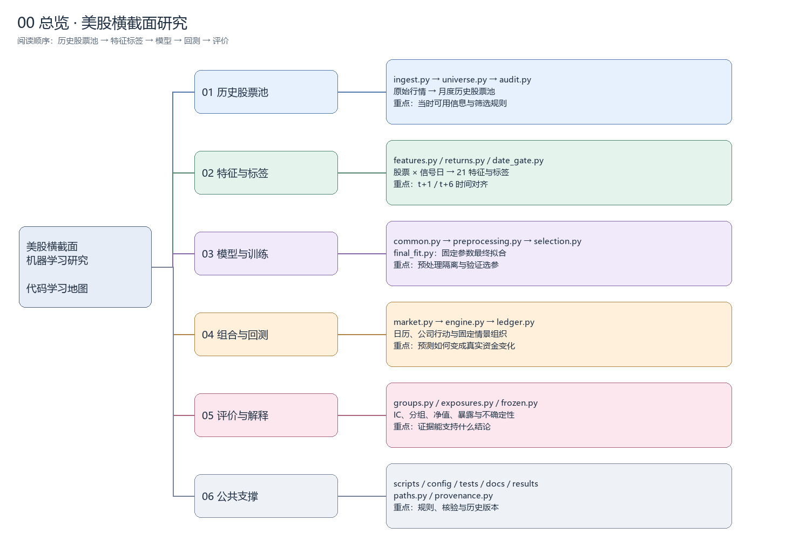

# 项目代码思维导图

优先使用 [两层阅读路线](READING_PATH.md)：先读核心研究逻辑，需要时再查阅下方完整函数索引。

生成日期：2026-10-22。按学习顺序组织，不是严格的调用图；同一文件可以提供多个阶段共用的功能。

## 如何编辑

打开 https://app.diagrams.net/ ，选择 Device（设备），通过 File → Open From → Device 打开 `project-code-map.drawio`。无需连接 GitHub 或上传行情数据。
双击节点修改文字；拖动节点调整布局；使用连接点添加连线。底部页签在总览、五个模块和公共支撑之间切换。保存时下载并覆盖本地 `.drawio` 文件。
导图节点和连线均为独立可编辑对象。此文字大纲可直接在 VS Code 修改，但不会自动同步到图中。

## 阅读方式

先看 00 总览，再读 01–05。06 汇总入口、配置、测试与基础设施。每页由左到右：模块 → 子任务 → 文件职责 → 函数。
函数来自实际 Python AST；图中没有执行训练或读取授权数据。包目录的 `__init__.py` 只负责包声明，不逐个展开。

## 01 历史股票池

行情 → 月度历史股票池

- scripts/prepare_data.py ingest / universe / audit
- config/universe.json；crsp_query.example.json
- 产物：monthly_universe.parquet

### 导入与审计

- [data/ingest.py](../../src/equity_research/data/ingest.py)：分块读取、去重和保留原始标记
  - `write_json()`
  - `deduplicate()`
  - `ingest()`

- [data/audit.py](../../src/equity_research/data/audit.py)：核验股票池产物与数据口径
  - `digest()`
  - `main()`

### 历史筛选

- [data/universe.py](../../src/equity_research/data/universe.py)：月末状态 → 公司去重 → 流动性前 500
  - `filter_codes()`
  - `regular_trade()`
  - `monthly_snapshots()`
  - `select_month()`
  - `semantic_audit()`
  - `build()`

## 02 特征与标签

历史信息 → X 与未来收益 y

- scripts/prepare_data.py returns / features / validate
- config/features_labels.json
- 产物：features_labels.parquet；features_only.parquet

### 样本构造

- [data/features.py](../../src/equity_research/data/features.py)：21 特征、t+1 至 t+6 标签、边界掩码
  - `compound_past()`
  - `make_features()`
  - `return_segments()`
  - `label_one()`
  - `split_masks()`
  - `main()`

### 异常与核验

- [data/returns.py](../../src/equity_research/data/returns.py)：异常收益、跨期收益和补充事件审查
  - `selected_parts()`
  - `main()`
  - `review_additional_events()`

- [data/validation.py](../../src/equity_research/data/validation.py)：独立验证特征与标签
  - `main()`

### 时间隔离

- [data/date_gate.py](../../src/equity_research/data/date_gate.py)：限制读取日期；保持全局信号日安排
  - `DateGate [类]`
  - `__init__()`
  - `read_parquet()`
  - `check_frame()`
  - `deny_test_execution()`
  - `signal_schedule()`

## 03 模型与训练

训练输入 → 冻结配置与模型

- scripts/train_models.py select / final-fit
- config/full_train_selection.json；final_test_plan.json
- 四组：原始 / 排名 × Ridge / LightGBM；不再三折选参

### 共享计算

- [models/common.py](../../src/equity_research/models/common.py)：样本边界、模型网格、IC；兼容导出预处理
  - `load_development_data()`
  - `sample_masks()`
  - `daily_rank_ic()`
  - `circular_block_interval()`
  - `model_grid()`
  - `new_model()`
  - `save_lightgbm()`
  - `load_lightgbm()`

- [models/preprocessing.py](../../src/equity_research/models/preprocessing.py)：横截面排名、截尾填补、标准化与状态
  - `fit_preprocessing()`
  - `transform_features()`
  - `require()`
  - `frame_digest()`
  - `cross_sectional_rank()`
  - `fit_state()`
  - `checked_ic()`
  - `metric()`

### 选择与拟合

- [models/selection.py](../../src/equity_research/models/selection.py)：2015–2019 训练；2020–2021 验证选参
  - `selected_candidates()`
  - `prior_hashes()`
  - `pair_results()`
  - `main()`

- [models/final_fit.py](../../src/equity_research/models/final_fit.py)：固定参数，用 2015–2021 合格样本拟合
  - `eligibility()`
  - `read_final_inputs()`
  - `protected_hashes()`
  - `main()`

### 独立核验

- [models/validation.py](../../src/equity_research/models/validation.py)：复算开发期预测、排序与隔离
  - `report()`
  - `main()`

- [models/verification.py](../../src/equity_research/models/verification.py)：核验最终训练日期和模型保存一致性
  - `main()`

## 04 组合与回测

预测分数 → 持仓、交易与净值

- scripts/backtest.py validation / test
- prepare_data.py validation-events / test-audit / test-events
- 预测 ≠ 成交；标签收益 ≠ 真实组合净值

### 行情与交易引擎

- [backtest/market.py](../../src/equity_research/backtest/market.py)：行情矩阵、目标选股与组合统计
  - `read_predictions()`
  - `load_inputs()`
  - `make_targets()`
  - `audit_inputs()`
  - `build_market()`
  - `performance()`

- [backtest/engine.py](../../src/equity_research/backtest/engine.py)：逐日模拟、成本、公司行动与账本核对
  - `simulate()`
  - `verify()`

### 资金与结算

- [backtest/ledger.py](../../src/equity_research/backtest/ledger.py)：应收应付、购买力和未来资金约束
  - `Ledger [类]`
  - `__init__()`
  - `post()`
  - `settle()`
  - `balances()`
  - `path()`
  - `budget()`
  - `check()`

- [backtest/settlement.py](../../src/equity_research/backtest/settlement.py)：历史结算日期算法
  - `SettlementCalendar [类]`
  - `__init__()`
  - `supported()`
  - `is_settlement_day()`
  - `is_exchange_day()`
  - `settlement_date()`

- [backtest/calendar.py](../../src/equity_research/backtest/calendar.py)：完整测试日历与共享账本绑定
  - `Ledger [类]`
  - `__init__()`

- [backtest/validation_calendar.py](../../src/equity_research/backtest/validation_calendar.py)：验证期日历与共享账本绑定
  - `Ledger [类]`
  - `__init__()`

### 运行组织

- [backtest/validation.py](../../src/equity_research/backtest/validation.py)：准备输入 → 固定情景 → 保存核验
  - `simulate()`
  - `verify()`
  - `prepare_inputs()`
  - `run_scenarios()`
  - `save_results()`
  - `main()`

- [backtest/frozen.py](../../src/equity_research/backtest/frozen.py)：加载冻结模型、预测、运行固定测试情景
  - `inputs()`
  - `predictions()`
  - `main()`

### 公司行动资料

- [data/validation_events.py](../../src/equity_research/data/validation_events.py)：验证期事件登记
  - `main()`

- [data/event_audit.py](../../src/equity_research/data/event_audit.py)：测试期候选与事件审计
  - `main()`

- [data/test_events.py](../../src/equity_research/data/test_events.py)：核验事件条款，未决事件阻止执行
  - `possible_held_events()`
  - `main()`

## 05 评价与解释

预测 / 组合表现 → 研究结论

- scripts/evaluate.py test / validation-exposures
- 预测评价与净值评价分别计算
- 产物：汇总、分年统计、置信区间与展示图

### 信号诊断

- [evaluation/groups.py](../../src/equity_research/evaluation/groups.py)：分组收益、覆盖率与配对不确定性
  - `load_validation()`
  - `assign_groups()`
  - `boundary_dates()`
  - `circular_interval()`
  - `group_statistics()`
  - `summarize_groups()`
  - `verify_group_assignment()`

### 持仓解释

- [evaluation/exposures.py](../../src/equity_research/evaluation/exposures.py)：市值、波动率、beta、行业与收益贡献
  - `sic_group()`
  - `division()`
  - `style_snapshots()`
  - `attach_features()`
  - `load_inputs()`
  - `security_ledger()`
  - `summarize()`
  - `contribution_tables()`
  - `main()`

### 最终评价

- [evaluation/frozen.py](../../src/equity_research/evaluation/frozen.py)：测试 IC、净收益、区块区间和图表
  - `paired_interval()`
  - `make_figure()`
  - `main()`

## 06 公共支撑

### 六个运行入口

- `scripts/backtest.py`：命令行分发 / 环境检查
- `scripts/check_environment.py`：命令行分发 / 环境检查
- `scripts/evaluate.py`：命令行分发 / 环境检查
- `scripts/prepare_data.py`：命令行分发 / 环境检查
- `scripts/train_models.py`：命令行分发 / 环境检查
- `scripts/verify.py`：命令行分发 / 环境检查

### 基础设施

- `src/equity_research/paths.py`：统一项目根目录；ROOT：统一定位项目根目录
- `src/equity_research/provenance.py`：当前文件校验与历史源码快照；sha256() / hash_matches()

### 规则与环境

- `config/`：股票池、特征、选参、事件与结算规则
- `pyproject.toml`：src 包结构与依赖声明
- `requirements.txt / requirements.lock.txt`：直接依赖 / 原运行环境
- `pytest.ini / tests/conftest.py`：测试发现与包导入
- `.github/workflows/tests.yml`：GitHub 合成测试

### 独立测试与旧算法

- `tests/test_*.py`：数据、特征、模型边界、资金与事件核验
- `tests/test_engine_regression.py`：54 组费用、到账与事件组合的新旧对照
- `tests/reference/`：测试专用旧算法；生产代码不依赖

### 文档和产物

- `docs/`：研究协议；历史方案不等于当前执行规则
- `results/`：公开汇总与展示图
- `data/ / outputs/`：本地授权数据、模型、预测和持仓
- `archive/ / reports/`：本地历史快照与工作报告

## 测试文件索引

- `tests/conftest.py`
- `tests/reference/corporate_actions.py`
- `tests/reference/cv.py`
- `tests/reference/ledger.py`
- `tests/reference/portfolio.py`
- `tests/reference/preflight.py`
- `tests/test_action_portfolios.py`
- `tests/test_baseline_models.py`
- `tests/test_crsp_pipeline.py`
- `tests/test_engine_regression.py`
- `tests/test_execution_preflight.py`
- `tests/test_features_labels.py`
- `tests/test_final_fit.py`
- `tests/test_final_funding.py`
- `tests/test_final_funding_exposures.py`
- `tests/test_final_test_engine.py`
- `tests/test_full_selection_backtest.py`
- `tests/test_prediction_groups.py`
- `tests/test_provenance.py`
- `tests/test_temporal_cv.py`

## 配置文件索引

- `config/baseline_models.json`
- `config/corporate_actions.json`
- `config/crsp_query.example.json`
- `config/features_labels.json`
- `config/final_test_plan.json`
- `config/full_selection_backtest.json`
- `config/full_train_selection.json`
- `config/prediction_diagnostics.json`
- `config/settlement_calendar.json`
- `config/temporal_cv.json`
- `config/test_execution_calendar_v1.json`
- `config/universe.json`
- `config/validation_corporate_actions.json`

历史 temporal_cv 配置与 reference/cv.py 只用于保留对照；最终选参入口不运行三折 CV。
