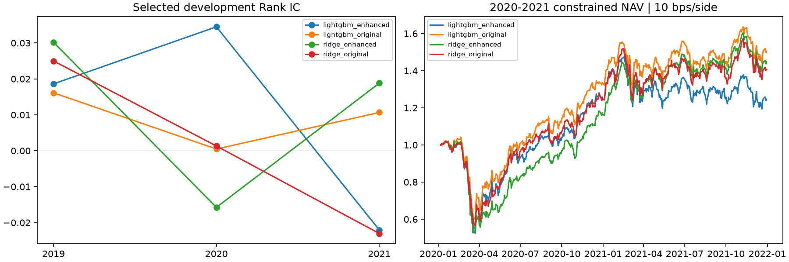

# 第二轮：市场与行业背景特征比较

2026-11-07。固定 12 个新增特征、两个时间窗口和参数网格后，完成 32 次候选拟合，无最终重拟合；为第三轮保留 16 次候选预算。2022–2025 行情、标签、预测和表现未读取。原有产物的大小/修改时间不变，第一轮组合规则未改。

定义和范围见 [冻结设计](../../docs/CONTEXT_FEATURES_V2.md)；机器配置见 [context_features_v2.json](../../config/context_features_v2.json)。运行 `python scripts/train_models.py context-v2`；已有实验目录拒绝覆盖。

## 预测结果

| 设计 | 入选参数 | 2019 Rank IC | 2020–2021 Rank IC | 两窗口等权平均 |
|---|---|---:|---:|---:|
| Ridge，原 21 特征 | alpha=1,000 | 0.02500 | −0.01061 | 0.00720 |
| Ridge，增强 33 特征 | alpha=1,000 | 0.03021 | 0.00118 | **0.01570** |
| 排名 LightGBM，原 21 特征 | 7 叶 | 0.01613 | 0.00547 | 0.01080 |
| 排名 LightGBM，增强 33 特征 | 63 叶 | 0.01862 | 0.00679 | **0.01270** |

Ridge 的两窗口平均 IC 提升 0.00850；LightGBM 提升 0.00190。2019 有 49 个合格评价信号日，2020–2021 有 100 个；按冻结规则两窗口各占一半权重，没有将 149 个日期直接混合平均。

Ridge 四个相同 alpha 下的增强减原始平均 IC 差均为正，分别约 +0.00802、+0.00801、+0.00850、+0.00301。LightGBM 同叶数比较则为：7 叶 −0.00053、15 叶 −0.00534、31 叶 −0.00403、63 叶 +0.00531。增强特征对树模型的收益依赖树规模，不能把“增强 63 叶优于原始 7 叶”全部解释为特征信息独立增加。

10 个信号日区块、2,000 次重采样，在窗口内分别采样再等权合并，增强减原始 IC 的 95% 区间：Ridge [−0.00787, +0.02585]；LightGBM [−0.02272, +0.02723]，均跨零。这些是选参窗口上的描述性区间，未校正候选选择，不是独立确认性证据。

## 时间稳定性

| 设计 | 2020 IC | 2021 IC |
|---|---:|---:|
| Ridge 原始 | 0.00132 | −0.02303 |
| Ridge 增强 | −0.01577 | 0.01882 |
| LightGBM 原始 | 0.00048 | 0.01066 |
| LightGBM 增强 | 0.03450 | −0.02205 |

新增背景改变了两个模型在不同年份的行为。Ridge 的改善主要来自 2021，2020 反而变差；LightGBM 2020 提升、2021 失效。两个总窗口的均值改善掩盖了这种年度反转，尚不能称为稳定适应市场状态。

## 保持第一轮规则的 2020–2021 组合回放

每个设计复用窗口 2 中已拟合的入选候选；先保存选择结果，再回放组合，组合收益不参与改选。2019 仅评价预测，未扩展未经完整核验的公司行动账本。

| 设计 | 原前 10% 组合 CAGR | 风险约束 CAGR | 风险约束 Sharpe | 风险约束最大回撤 |
|---|---:|---:|---:|---:|
| Ridge 原始 | 16.13% | 18.69% | 0.668 | −44.73% |
| Ridge 增强 | 4.41% | 20.55% | 0.718 | −48.67% |
| LightGBM 原始 | 27.07% | 22.81% | 0.779 | −43.11% |
| LightGBM 增强 | 25.63% | 11.67% | 0.482 | −48.26% |

原始表示 Ridge、排名表示 LightGBM 的本轮基线经过新的固定网格选参，与第一轮旧模型参数不同。表内是本轮同条件对照，不替换旧正式结果，也不将不同参数间差异归因于特征。

Ridge 的增强特征改善整体排序，但前 10% 组合 CAGR 从 16.13% 降到 4.41%。对应严格可评价样本的最高十分位平均未来五日超额收益，从约 +15.50 bps 降到 −4.30 bps，说明整体 IC 改善没有改善顶端选股。风险约束改变持仓后，CAGR 从 18.69% 升至 20.55%，但最大回撤更深，仍是有取舍的结果。

LightGBM 增强后的最高十分位平均标签收益从约 41.16 bps 到 45.77 bps，但其原组合净 CAGR 下降，风险约束后下降更多。分组标签是按日期等权的未来超额收益，排除无法严格评价的标签；组合则包含资金路径、交易失败、公司行动、费用和复利，两者不能直接等同。

约束组合每次单边平均换手，Ridge 从 55.34% 到 56.73%，LightGBM 从 65.05% 到 77.25%；LightGBM 年化日费用率从 6.59% 到 7.82%。费用率指每日费用/交易前净值均值乘 252，并非零成本回测的 CAGR 差。增强 LightGBM 的风险约束年度收益在 2020 从 33.33% 降到 24.88%，2021 从 12.85% 降到 −0.28%。这一差异不能单靠较高 IC 解释。

## 核验与下一步

- 32 条唯一拟合记录，训练标签边界逐窗核验；所有选中模型的保存预测重新载入核对，并用 SciPy 独立复算逐日 Spearman。
- 400 个风险目标通过单股、行业、beta、波动边界检查；八条组合共 4,016 个组合日通过资金与应收应付账本核验。目标约束与成交后实际偏差分开记录，沿用第一轮对费用、失败买入、继承股票与漂移的说明。
- 特征测试覆盖标签不可影响聚合、未来日期不可改变历史特征、非合格股票排除、小行业回退、年化单位、训练预处理与标签跨界。
- 原 21 特征、原结果、第一轮规则保留。新增市场变量来自当时合格股票池，行业为历史有效 SIC；未引入外部宏观或财报信息。

目前证据支持继续保留增强 Ridge 作为候选，对增强 LightGBM 不作优越性结论。下一轮可按预留的 16 次拟合预算比较排序目标，检验整体排序、顶端选股和风险约束组合之间的差异；本轮不根据组合表现换参数、不使用 2022–2025 选参。

核心文件：selection.csv、selected_window_metrics.csv、candidate_metrics.csv、annual_ic.csv、paired_ic.csv、paired_equal_window_ic.csv、portfolio_metrics.csv、annual_returns.csv、label_deciles.csv。同参数对照见两个 matched_parameter_deltas.csv；个股特征、模型与预测仅留本地 outputs/context_selection_v2。
