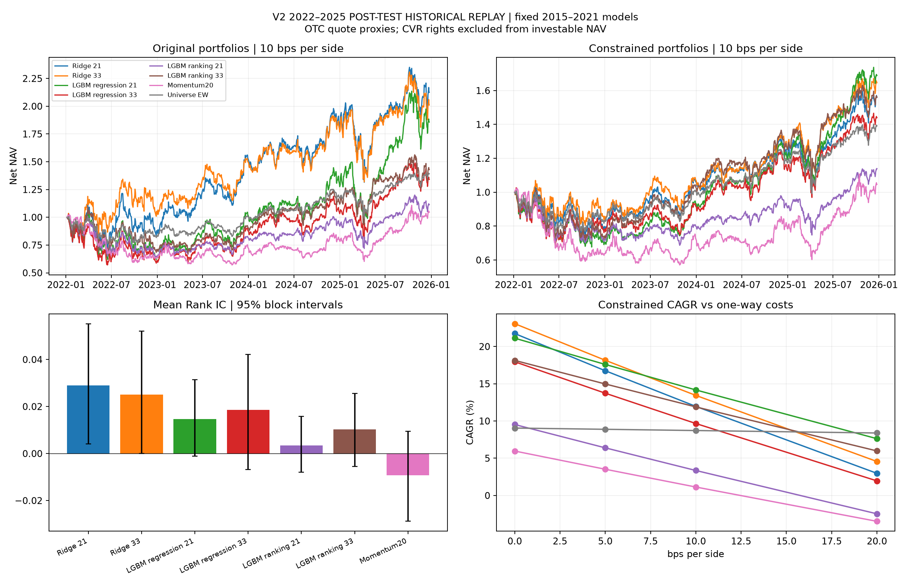

# V2：2022–2025 事后历史稳健性评价

六组模型使用冻结参数及 2015–2021 最终拟合权重。本次新增拟合和调参均为 0；原结果保留，未读取新的未见数据。2022–2025 已在此前研究中看过，本轮结果不属于独立未见测试。

主模型保持增强 Ridge，主要对照保持原有 Ridge；增强排序 LightGBM 仍为挑战模型。

## 同条件组合结果

单边 10 bps、公司行动 lag 2、普通卖款可再投资、历史应收应付及 T+2/T+1 日历。原始组合为前 10% 等权；风险约束沿用单股 2%、行业主动权重 ±2%、beta 主动暴露 ±0.1、个股年化波动率加权均值不超过等权基准 +0.1。最后一项不是组合波动率目标。

| 模型 | 原始 CAGR | 约束 CAGR | 约束 Sharpe | 约束最大回撤 | 平均 Rank IC |
|---|---:|---:|---:|---:|---:|
| Ridge 21 | 21.01% | 11.97% | 0.561 | -28.89% | 0.0290 |
| Ridge 33 | 19.34% | 13.44% | 0.616 | -24.75% | 0.0251 |
| LGBM regression 21 | 16.96% | 14.17% | 0.643 | -32.55% | 0.0146 |
| LGBM regression 33 | 7.70% | 9.67% | 0.486 | -33.01% | 0.0187 |
| LGBM ranking 21 | 2.75% | 3.36% | 0.259 | -32.00% | 0.0035 |
| LGBM ranking 33 | 9.45% | 11.89% | 0.575 | -29.69% | 0.0104 |

| 基准 | CAGR | Sharpe | 最大回撤 |
|---|---:|---:|---:|
| Momentum20 | 1.14% | 0.177 | -44.27% |
| Universe EW | 8.72% | 0.504 | -24.22% |

## 预先指定的主要比较

增强 Ridge 减原有 Ridge，风险约束组合的年化平均日净收益差为 **1.21%**，20 日配对循环区块 Bootstrap、2,000 次重采样的 95% 区间为 **[-4.37%, 6.78%]**。这是日收益差均值乘 252，不是 CAGR 差。

区间判读：区间未排除零或指向负向，不能据此宣布增强信息带来稳定净收益改善；主模型身份不变。

其他参数、模型和组合的差异均作辅助解释。逐日 IC 使用连续严格标签，NDCG 使用冻结的 0–9 级与线性 gain。前 10% 选股先在全部可选股票中确定，再统计有效标签覆盖；顶部标签收益与实际净值收益分开报告。

## 如何理解这次改进

**风险约束的主要效果是降低风险，而不是普遍提高年化收益。** 原有 Ridge 从原始组合的 21.01% CAGR、40.52% 年化波动、−37.03% 最大回撤，变为约束组合的 11.97%、26.30%、−28.89%。增强 Ridge 的年化波动从 38.79% 降至 25.92%，最大回撤从 −32.98% 改善到 −24.75%。这说明原始策略的高收益包含较大的风险承担；约束后的结果更适合在相近暴露条件下比较。约束仍留有行业/beta 容差，不能称为完全中性或风险完全相同。

**增强 Ridge 的优势主要体现于约束组合和 2022 年防守，预测增量并不稳定。** 在约束组合中，增强版 2022 年收益为 −14.19%，原有版为 −20.25%；2023 年则分别为 +25.33% 和 +33.55%。全期平均 Rank IC 从原有版 0.0290 降至增强版 0.0251，原始前 10% 组合 CAGR 也从 21.01% 降至 19.34%。因此不能把约束组合的改善直接归因为“新特征普遍增强预测能力”。主要净收益差区间包含零，主模型身份继续保留，但不宣布增量已经得到确认。

**更多背景特征没有普遍帮助 LightGBM 回归。** 增强版平均 IC 从 0.0146 提高到 0.0187，但前 10% 股票的平均严格五日超额收益标签从约 0.360% 降至 0.210%，约束组合的平均调仓换手从 58.42% 升至 72.08%，净 CAGR 从 14.17% 降至 9.67%。整体排序、顶部收益和交易成本给出了不同的信息，不能只看 IC 选结论。

**排序目标在增强特征下有改善迹象，但未取代回归基线。** 增强排序的约束 CAGR 为 11.89%，高于增强回归的 9.67%，但其年化平均日净收益差的辅助区间为 [−6.03, +9.68] 个百分点，仍包含零；它也低于原有特征回归的 14.17%。原有特征排序只有 3.36% 约束 CAGR，低于等权基准的 8.72%。开发期排序模型的突出表现没有完整延续到这段历史回放。原有特征回归本次约束 CAGR 最高，但不会因此替换冻结主模型。

树模型之间比较的是各设计按同一预算选出的最终配置，叶数并不完全相同。因此这些结果说明整个设计方案的表现，不能把全部收益差唯一归因于增加特征或更换目标函数；同叶数的目标对照仍以第三轮开发期配对结果为依据。

**交易成本仍是主要薄弱环节。** 增强 Ridge 的约束 CAGR 在单边 0 / 10 / 20 bps 下分别为 23.07% / 13.44% / 4.57%；同档 20 bps 等权基准为 8.39%。单边 20 bps 时六组约束模型均低于等权。后续若研究降低换手，应单独冻结新实验，不能反过来改写本次结果或从成本曲线挑选主口径。

## 目标约束与真实持仓偏差

1,194 个模型目标组合全部满足冻结约束。成交时点按净值计算的实际权重不保证严格达标：费用降低分母，会使贴着 2% 上限的持仓出现微小超限；无法成交、继承证券和公司行动也可能带来更明显的偏差。原规则未进行额外事后再平衡，本次保持一致。

调仓成交时点，增强 Ridge 的最大单股权重约为 2.004%，但其在当期股票池可覆盖部分的最大行业主动权重达到 3.913%、最大 beta 主动偏差达到 0.123；增强回归最大单股权重达到 2.266%。增强 Ridge 最低可匹配股票池的权益/NAV 覆盖约为 95.94%，差额包含现金、应收款和池外继承持仓等。暴露统计使用当期信号特征，不应把未覆盖权益当成零风险。全期目标与成交摘要见暴露表；实际每日持仓保存在本地，可支持后续更细的归因。

这些事实使本次结论更具体：风险约束降低了整体风险，模型改进存在明显的目标、年份和成本依赖；尚无充分证据说明复杂模型或增强信息持续优于简洁基线。新未见期评价仍需按原方案独立推进。

## 覆盖、风险与执行核验

- 199 个完整信号，997 个净值日期；99,500 条候选、99,287 条合格严格标签。
- 14 条主组合与 42 条成本敏感性路径，共 56 条；13,958 个主组合日期完成独立资金/净值核对。
- 原 2015-01-02 锚定的五交易日信号网格保持不变；第一信号为 2022-01-05、首次成交为 2022-01-06、最后清算为 2025-12-24。年度统计因此首尾为实际完整策略窗口，不包括被边界规则剔除的零碎持有期。
- 等权基准复现原 V1 净值。每条路径独立由现金 NAV=1 开始；无模型滚动更新。
- 目标约束单独核验；成交后的暴露、覆盖不足、调仓间漂移和事件继承不会被当成目标达标。公开暴露为调仓成交时点，用当期信号暴露衡量；不等于全日频因子归因。
- 银行退市仍使用已批准的首个退市后报价强制处置代理；CVR 登记但不进入可投资净值。报价不是实际成交验证，CVR 最大金额不是公允价值。
- 原有模型、结果及冻结参数源保持不变。新的未见期资格仍待审计。
- 最终相关自动化测试 153 项通过；两个基准在四档成本下均复现 V1 净值。主要区块区间另以独立逐次重采样实现核对一致。853 个既有产物的大小和修改时间保持不变，冻结模型和本轮输入源码哈希均核对通过。

## 文件

- [组合指标与成本敏感性](portfolio_metrics.csv)、[年度净收益](annual_returns.csv)、[季度净收益](quarterly_returns.csv)。
- [预测指标](predictive_metrics.csv)、[年度 IC](annual_ic.csv)、[配对 IC 区间](paired_ic.csv)、[顶部标签及覆盖](top_decile_labels.csv)。
- [收益差配对区间](paired_return_intervals.csv)、[目标与成交暴露](exposure_summary.csv)、[逐日标签覆盖](label_coverage.csv)。
- [主要比较](primary_comparison.json)、[执行核验](verification.json)。个股预测、交易、持仓与事件明细保存在本地 `outputs/historical_replay_v2/`。

