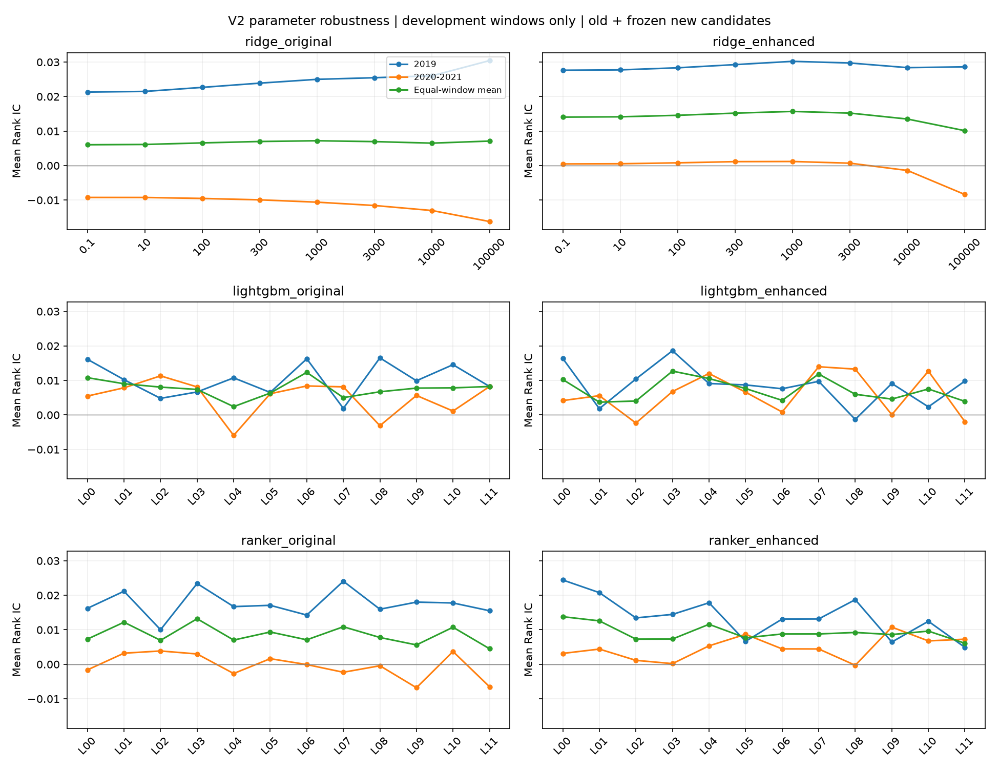

# V2 参数稳健性扩展：开发期统一评价

**本轮完成 48 个旧候选窗口的真实复用校验与 80 次新增拟合，合计比较 64 个设计—参数配置、128 条候选窗口结果。六种设计中五种保留旧候选，只有原有 21 特征 LightGBM 回归改选为 300 棵树。新增搜索没有改变增强 Ridge 的平均 IC 领先，也没有解决跨时期不稳定。**

本轮使用 2015–2018→2019、2015–2019→2020–2021 两个窗口，按窗口内日期等权、窗口间各 50% 选择参数。原 V1/V2 产物保留；没有最终拟合、组合回测或读取 2022–2025 表现。本报告的收益标签均为五日超额收益标签，不是扣费组合收益。

依据：[冻结网格与预算](../../docs/PARAMETER_ROBUSTNESS_V2.md)、[原候选审计](../search_audit_v2/README.md)。本轮入选仅作为开发期结果，原冻结主模型与最终模型权重保持不变。

## 1. 扩大网格后，参数选择有什么变化

树模型参数依次为「叶数／树数／最小叶节点样本数」。IC 使用原始小数，不表示收益率。

| 设计 | 本轮入选 | 原平均 IC | 本轮平均 IC | 2019 IC | 2020–2021 IC | 变化 |
|---|---|---:|---:|---:|---:|---|
| Ridge 21 | alpha=1,000 | 0.007196 | 0.007196 | 0.025003 | −0.010612 | 不变 |
| Ridge 33 | alpha=1,000 | **0.015699** | **0.015699** | 0.030215 | 0.001183 | 不变 |
| LightGBM 回归 21 | **7／300／500** | 0.010799 | **0.012335** | 0.016270 | 0.008400 | 原为 7／100／500 |
| LightGBM 回归 33 | 63／100／500 | 0.012703 | 0.012703 | 0.018617 | 0.006789 | 不变 |
| LightGBM 排序 21 | 63／100／500 | 0.013207 | 0.013207 | 0.023419 | 0.002995 | 不变 |
| LightGBM 排序 33 | 7／100／500 | 0.013796 | 0.013796 | 0.024438 | 0.003154 | 不变 |

原有回归 LightGBM 增加树数后，2019／2020–2021 的 IC 分别提高 **0.000143／0.002930**，两窗口平均提高 **0.001536**。配对循环区块 Bootstrap 的等窗口 95% 区间为 **[−0.003228，0.006033]**；两个单独窗口的区间也包含零。这是开发期点估计改善，增量尚未获得稳定统计支持。

其他五组选择相同，因此新旧入选的差及区间均为零；这表示比较对象完全相同，不表示其预测能力没有不确定性。六组之间的平均 IC 名次保持不变。

## 2. 原来的四个候选是否遗漏了关键参数区域

**Ridge 的局部加密保留了原选择。** 100、300、3,000、10,000 四个新增 alpha 都未超过 1,000。增强 Ridge 在两个窗口仍同时偏好 1,000；3,000 成为第二名，平均 IC 为 0.015212，与第一名差 0.000487，显示最优附近并非陡峭尖峰。原有 Ridge 的第一、二名仍只相差 0.000091，八个候选在第二窗口全部为负，两个窗口的候选优劣顺序仍完全相反。

**树模型的叶数边界得到更直接的检查。** 新增 3／127 叶后，四组入选叶数都位于扩展叶数范围内部。原设置下的边界对照如下：

| 设计 | 3 叶减 7 叶：平均 IC 差 | 127 叶减 63 叶：平均 IC 差 |
|---|---:|---:|
| 回归 21 | −0.008393 | −0.001055 |
| 回归 33 | +0.000285 | −0.005051 |
| 排序 21 | −0.000277 | −0.003846 |
| 排序 33 | −0.002206 | +0.000349 |

增强回归原先 63 叶在两个窗口都最优，但扩展到 127 叶后两个窗口都下降。增强排序的 3 叶低于 7 叶；其 127 叶虽略好于较弱的 63 叶对照，仍远低于入选 7 叶。原边界入选没有转化为继续向外扩张的明确收益。

**增加树数或减小叶节点样本下限，效果取决于设置与时期。** 最清楚的例子是增强回归在 63 叶、最小样本数 500 时，将树数从 100 改为 300：2019 IC 降低 0.008874，第二窗口提高 0.007178，平均仍下降 0.000848。它成为第二名，但没有超过旧候选。

增强排序在 7 叶、最小样本数 500 时增加树数，2019 下降 0.011328、第二窗口提高 0.001312，平均下降 0.005008。原有回归在 7 叶降低最小样本数至 100，则平均 IC 下降 0.004086。不能把更多树或更小叶节点样本下限概括为普遍改善。

完整 2×2 对照和二阶差分见 [factorial_effects.csv](factorial_effects.csv)。其中交互表示「同时改变树数与样本下限的效果，减去两项单独效果」，不代表因果解释或额外统计显著性检验。

## 3. 同参数对照是否改变特征与目标的结论

| 对照 | 同配置数量 | 等窗口平均差为正 | 两窗口都改善 |
|---|---:|---:|---:|
| Ridge：增强减原有 | 8 | 8 | **7** |
| 回归 LightGBM：增强减原有 | 12 | 4 | 2 |
| 排序 LightGBM：增强减原有 | 12 | 8 | 3 |
| 原有特征：排序减回归 | 12 | 7 | 2 |
| 增强特征：排序减回归 | 12 | 10 | 2 |

**Ridge 的背景特征增量仍最一致。** 八个 alpha 的平均增量都为正，七个在两个窗口同时改善；唯一例外仍为 alpha=100,000 在 2019 的下降。该发现扩展了原四点网格的证据范围，但对应等窗口区间均包含零。

**树模型需要更细的条件描述。** 原四个候选中，增强回归在第二窗口全部低于同参数原有版；扩展到 12 组后，第二窗口有 5 组改善，其中 127／100／500、63／300／500 在两窗口都改善。这说明原观察不能推广到所有训练设置。整体上仅 4/12 组平均增量为正，仍不支持背景特征普遍有益。

**排序目标也出现局部例外，但未形成普遍优势。** 原有特征下，3／100／500 与 7／300／100 的排序减回归差在两个窗口都为正；增强特征下，这一条件由 31／100／500 与 7／300／500 满足。其余很多正平均差仍包含窗口取舍。相对某个弱对照改善，不等于该排序配置的绝对 IC 最好。

在所有 56 个同参数对照，以及 6 个入选减旧入选比较中，等窗口 95% 区间均包含零。区间使用同窗口共用日期索引的 10 信号日循环区块、2,000 次重采样；两个窗口独立采样后等权合并。它们基于已反复使用的开发数据，未校正模型选择与多重比较，不能解释为独立确认。

## 4. IC 改善是否同时改善顶部选股

只有原有回归 LightGBM 改选参数，重点比较这组。以下标签收益按有效日期等权，NDCG 在严格可评价样本内计算；前 10% 名单先在完整合格预测池中确定，再检查标签可用性。

| 评价期 | 设置 | Rank IC | NDCG 前 10% | 顶部平均五日超额标签 |
|---|---|---:|---:|---:|
| 2019 | 7／100／500 | 0.016127 | 0.503948 | +8.41 bps |
| 2019 | 7／300／500 | 0.016270 | 0.507570 | +8.21 bps |
| 2020–2021 | 7／100／500 | 0.005470 | 0.487759 | +37.67 bps |
| 2020–2021 | 7／300／500 | 0.008400 | 0.487017 | +32.62 bps |

新配置的整体 IC 提高，但顶部平均标签收益在两个窗口都略降；第二窗口 NDCG 也略降。因此本轮不能由 IC 提升推断组合收益提高，更没有新的净 CAGR 结果。

逐年看，新入选原有回归模型的 IC 为 2019 **0.016270**、2020 **0.006839**、2021 **0.010025**。其他入选模型仍存在明显年度反转，例如增强 Ridge 为 2020 −0.015766、2021 +0.018823；增强排序为 +0.016099、−0.010320。

## 5. 对项目结论的影响

- **得到加强的结论**：增强 Ridge 的开发期平均 IC 领先，以及多数配置的时期依赖，在本轮针对性搜索下仍然成立。原 4 候选网格没有在这次扩展范围内遗漏一个明确、更稳定的整体赢家。
- **需要更新的细节**：原有 LightGBM 回归应记录本轮开发期新候选 7／300／500；“所有设置都出现同一方向反转”的描述应限定于原网格，扩展配置已经出现局部双窗口改善。
- **仍未确认的内容**：更高扣费组合收益、长期预测优势，以及整个参数空间的最优性。本轮预算已经用完，不因新入选树数为 300 的上边界再追加候选。

本轮没有依据替换既有最终模型。结果适合在求职展示中作为参数敏感性与研究结论稳健性的补充：扩展搜索只带来一项有限的开发期 IC 改善，未改变主要模型排序，而顶部收益与 IC 的差异仍然存在。

## 核验、覆盖与文件

- 真实 48 个旧候选：来源、参数、预处理、训练标签边界、完整评价预测及独立日 IC 全部核验通过；旧 24 个等窗口平均值再次复现。
- 80 个新增模型均已完成，失败和额外拟合为 0；逐个重新加载保存模型，参数一致，每个模型 101 个分散评价位置的预测与保存结果一致。全部候选的完整逐日 IC 已独立复算。
- 每个候选有 50／101 个完整预测信号日，严格 IC 有效日为 49／100。2019、2021 各有一个窗口末端信号因标签跨界没有可评价标签；覆盖表保留这些信号，IC 和标签收益记为缺失，不填零。故日诊断表为 9,664 行，其中有效 IC 为 9,536 行。
- 64 个配置、128 条窗口结果、192 条年度结果、56 个同配置对照和 6 个选中差异，共 186 条逐窗口／等窗口置信区间。覆盖均值包含上述无标签信号；NDCG 与顶部标签均值按有定义的信号日统计。
- 本轮新增评价单元测试 6 项、真实产物独立核验 3 项通过。此前执行入口的 27 项合成测试记录保留。开始前登记的 998 个既有产物，大小与修改时间全部不变；冻结输入和原配置哈希核对通过。
- 原始数据、逐股预测和模型权重仍仅存本地；公开目录只含聚合结果。未执行最终拟合、组合回测或 2022–2025 回放。

文件：[入选与旧候选对照](selection.csv)、[所有候选排序与参数](candidate_ranking.csv)、[逐窗口指标](candidate_window_metrics.csv)、[逐年指标](candidate_annual_metrics.csv)、[逐日 IC／NDCG／顶部标签及覆盖](candidate_daily_metrics.csv)、[配对差异与区间](paired_ic_intervals.csv)、[训练设置交互](factorial_effects.csv)、[叶数边界](boundary_effects.csv)、[执行与评价核验](verification.json)。

评价入口：`python scripts/evaluate.py robustness-v2`。已有公开结果时拒绝覆盖；该入口不训练模型。个股及拟合账本位于本地 `outputs/parameter_robustness_v2/`。

Ridge 横轴为离散 alpha 点；树模型横轴 L00–L11 对应冻结配置表，不是单一连续复杂度轴，连线仅帮助阅读候选差异。
