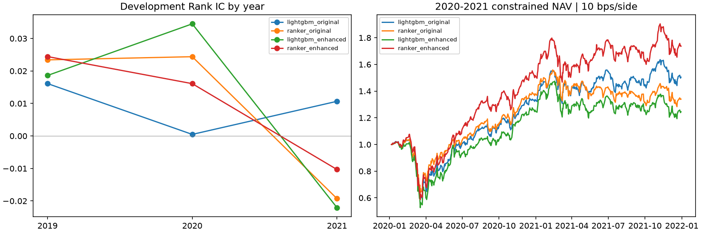

# 第三轮：排序目标与回归目标对照

2026-11-07 完成。先冻结 [排序定义和网格](../../docs/RANKING_V2.md)，再运行 16 次拟合；第二、三轮累计 48 次候选额度全部用完，无最终拟合、无额外调参。没有读取 2022–2025 行情、标签、预测或表现。第二轮回归模型及组合结果直接读取复用，原有产物保持不变。

每个训练信号日是一组 query，未来五日超额收益转为 0–9 级，平均并列排名，同收益同级。LambdaRank 使用线性增益和固定 truncation=53，树规模 7/15/31/63；其余训练设置与第二轮相同。复用同窗口原 21/增强 33 维特征及完全相同的预处理文件。

## 固定选择规则下的结果

| LightGBM 方案 | 入选叶数 | 2019 IC | 2020–2021 IC | 两窗口等权 IC |
|---|---:|---:|---:|---:|
| 回归，原有特征 | 7 | 0.01613 | 0.00547 | 0.01080 |
| 排序，原有特征 | 63 | 0.02342 | 0.00299 | 0.01321 |
| 回归，增强特征 | 63 | 0.01862 | 0.00679 | 0.01270 |
| 排序，增强特征 | 7 | 0.02444 | 0.00315 | 0.01380 |

两个排序模型的平均 IC 小幅改善，均主要来自 2019；2020–2021 整体 IC 反而下降。增强 Ridge 的第二轮平均 IC 为 0.01570，仍高于本轮两种排序方案。入选参数严格由两窗口等权 Rank IC 决定，未因组合收益换参数。

排序减对应回归的等窗口 IC 差：原有特征 +0.00241，10 信号日区块 95% 区间 [−0.01265, +0.01699]；增强特征 +0.00109，区间 [−0.01801, +0.02093]。两者均跨零，不能确认稳定排序能力提升。

同叶数对照也不一致。原有特征在 7/15/31/63 叶的等窗口 IC 差依次为 −0.00350、+0.00315、−0.00112、+0.00582；增强特征依次为 +0.00353、+0.00889、+0.00326、−0.00538。排序目标与特征、树规模存在交互，不能把不同入选树规模的全部差异解释为纯损失效应。本实验同时改变损失与标签离散化。

## 2020–2021 组合结果

| 方案 | 原前 10% CAGR | 风险约束 CAGR | 风险约束 Sharpe | 风险约束最大回撤 |
|---|---:|---:|---:|---:|
| 回归，原有特征 | 27.07% | 22.81% | 0.779 | −43.11% |
| 排序，原有特征 | 12.31% | 15.85% | 0.619 | −38.77% |
| 回归，增强特征 | 25.63% | 11.67% | 0.482 | −48.26% |
| 排序，增强特征 | **35.53%** | **31.98%** | **0.940** | −45.38% |

第一轮单股、行业、beta、历史波动约束、普通卖款可重用、历史结算账本、公司行动 lag 2 与单边 10 bps 成本不变。这里只回放窗口 2 的四条新排序组合；2019 仅评价预测，不扩展未核验事件账本。

增强排序模型在本次验证回放中更有竞争力，原有特征排序模型没有同步改善。增强排序模型的风险约束收益在 2020/2021 为 51.44%/14.64%，对应增强回归为 24.88%/−0.28%；优势来自两个年份。原有特征排序模型为 37.73%/−2.73%，对应回归为 33.33%/12.85%，其整体落后主要发生在 2021。

增强排序模型约束组合相对增强回归的算术年化平均日收益差为 +16.15 pp，20 日区块 95% 区间 [+1.26, +31.00] pp。区间在这个开发样本和区块设定下不跨零，但两者均在同一开发期选参，区间未校正模型选择，不是新的独立样本外证据；该统计量也不是 20.31 pp 的 CAGR 差。原有特征对应差 −6.38 pp，区间 [−22.30, +8.96] pp。

## 为什么 IC 和组合表现不同

| 2020–2021 方案 | NDCG 前 10% | 前 10% 平均五日超额标签 |
|---|---:|---:|
| 回归，原有特征 | 0.48776 | +37.67 bps |
| 排序，原有特征 | 0.49980 | +2.66 bps |
| 回归，增强特征 | 0.49381 | +47.38 bps |
| 排序，增强特征 | 0.50269 | +55.64 bps |

Rank IC 衡量全横截面，NDCG 侧重顶部等级，标签均值保留收益幅度；它们分别衡量不同目标。原有特征排序模型虽然 NDCG 更高，但顶端股票的平均收益金额明显更低，说明离散排序等级改善不保证经济收益改善。增强排序模型的 NDCG、顶部标签均值与扣费收益在该窗口同向改善，但 2019 的顶部标签均值反而低于增强回归。

本轮顶部集合统一按当日合格股票 ceil(n/10) 选取、分数并列按 PERMNO，之后再剔除不可严格评价标签；与第二轮旧十分位切箱表可能相差一只边界股票，因此这里全部从保存预测重算对照。NDCG 在严格可评价样本内计算，标签均值不是含费用和事件的实际投资收益。

增强排序模型约束组合的平均单边调仓换手从对应回归的 77.25% 降到 61.91%；年化日费用率从 7.82% 降至 6.28%，有助于扣费收益，但不能将 CAGR 的全部改善归因于成本。费用率是每日费用/交易前净值均值乘 252，并非零成本回测 CAGR 差。

排序模型的年度 IC 仍不稳定：增强排序 2020 为 +0.01610，2021 为 −0.01032；原有排序为 +0.02439、−0.01928。整体 IC 变负的年份，风险约束组合仍可能获利，原因包括市场收益、持仓集中于部分股票、调仓规则与资金路径；不能由正收益倒推模型具备稳定预测能力。

## 核验与研究结论

208 项测试通过，包括整数标签的独立 SciPy 排名复算、query 分组与训练标签边界、与第二轮预处理文件逐字节一致、保存模型预测复算和独立 Spearman。200 个新风险目标全部达标，四条组合的 2,008 个组合日通过资金与应收应付账本核验。实际成交暴露仍有费用、失败买入与继承持仓造成的偏差；约束并非调仓间每天的硬限额。

增强特征与排序目标的组合值得保留为下一阶段候选；原 21 特征排序模型不支持同样结论。原回归和 Ridge 对照继续保留，不能凭这次开发期收益将增强排序模型改称独立验证成功的最终赢家。冻结的 48 次候选预算已用尽，应先整理六种设计的统一证据和下一阶段方案，不继续追加网格，也不依据 2022–2025 表现选参。

入口：`python scripts/train_models.py ranking-v2`，存在目录时拒绝覆盖。主要文件：selection.csv、all_selection.csv、candidate_metrics.csv、window_ic.csv、annual_ic.csv、matched_leaf_deltas.csv、paired_equal_window_ic.csv、ranking_diagnostics.csv、comparison_portfolio_metrics.csv、comparison_annual_returns.csv、portfolio_paired_intervals.csv、verification.json。个股预测、训练等级标签、模型和持仓保留于本地 outputs/ranking_selection_v2。
