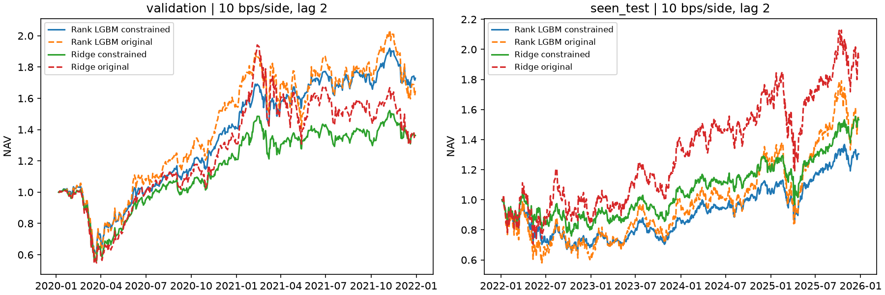

# 第一轮：固定风险约束下的现有预测回放

2026-11-07 完成。零重训、零新预测。原始结果和模型哈希不变，四条原路径复现，5,996 个组合日通过独立账本核验。方案见 [第二版研究规则](../../docs/RESEARCH_V2.md)。2022–2025 是已见数据上的事后研究。

## 2022–2025 年结果

| 组合 | 净 CAGR | 年化波动 | Sharpe | 最大回撤 | 信息比率 |
|---|---:|---:|---:|---:|---:|
| Ridge 原组合 | 18.27% | 40.18% | 0.617 | −36.69% | 0.603 |
| Ridge 风险约束 | 11.39% | 26.37% | 0.540 | −27.62% | 0.405 |
| 排名 LightGBM 原组合 | 11.56% | 42.70% | 0.469 | −43.25% | 0.371 |
| 排名 LightGBM 风险约束 | 6.96% | 25.85% | 0.389 | −34.40% | −0.057 |

原股票池等权净 CAGR 为 8.72%。两组约束组合的实现波动已较接近，Ridge 仍领先。CAGR 差由 6.71 pp 缩小到 4.43 pp。约束削弱风险倾向，但没有修复 LightGBM 的样本外选股表现。

调仓后、按信号日已知暴露测量的平均 beta，Ridge 从 1.790 降至 1.214，LightGBM 从 2.150 降至 1.235，股票池等权约 1.136。这是调仓时点均值，与旧报告的每日持仓均值口径不同。平均持仓股票年化波动分别由 64.45%、68.19% 降至 46.33%、45.95%；该量不是上表的组合实现波动。

## 年份差异与成本

| 年份 | Ridge 原组合 | Ridge 约束 | 排名 LightGBM 原组合 | 排名 LightGBM 约束 |
|---|---:|---:|---:|---:|
| 2020 | 31.00% | 20.83% | 54.94% | 41.17% |
| 2021 | 3.04% | 12.74% | 6.37% | 22.42% |
| 2022 | −11.73% | −17.84% | −37.06% | −29.99% |
| 2023 | 57.42% | 31.27% | 56.62% | 24.18% |
| 2024 | 17.41% | 10.00% | 21.25% | 19.19% |
| 2025 | 18.96% | 29.11% | 28.91% | 25.90% |

2022 年 LightGBM 的亏损减少约 7.07 pp，Ridge 收益反而下降约 6.12 pp，两者差距从 25.33 pp 缩小到 12.14 pp。降低总体风险没有保证每个年份都改善：约束同时改变了行业配置、个股选择和资金路径，不能把差距缩小的全部幅度解释为 beta 的因果贡献。

2023 年两者的收益都明显减少，说明约束也压缩了上涨年份的获利。2025 年 Ridge 的约束组合反而改善，进一步表明收益变化不是简单固定比例降杠杆。

测试期每次调仓平均单边换手（买卖金额之和的一半/净值），Ridge 从 74.98% 升至 82.17%，LightGBM 从 47.02% 升至 67.60%。日费用/交易前净值均值乘 252，分别从 7.58% 升至 8.30%、4.76% 升至 6.83%。这是年化费用率，不是另跑零成本净值得到的 CAGR 损失；优化暂未惩罚换手。LightGBM 原有低换手优势明显减弱。

验证期 Ridge 的 CAGR 从 16.29% 到 16.82%、Sharpe 从 0.562 到 0.622；LightGBM 从 28.57% 到 31.68%、Sharpe 从 0.788 到 0.986。验证期改善没有在已见测试期延续。验证期算术平均收益下降而 CAGR 上升并不矛盾，波动及复利路径同时变化。

## 约束与执行核验

598 个模型信号目标全部通过独立约束检查。目标全额投资、单股 ≤2%、SIC 行业偏离 ≤2 pp、beta 偏离 ≤0.10、持仓股票年化波动偏离上限 10 pp。目标不使用未来成交信息。

实际执行后的约束不是严格每日硬限额。几乎每次调仓都出现费用使净值分母减少造成的微小权重越界：测试期最大单股约 2.0038%。此外买入失败和公司行动会带来更大的行业偏差：Ridge 测试期最大行业偏离约 3.92 pp，LightGBM 约 2.13 pp；验证期 LightGBM 最大约 3.52 pp。详细次数见 exposure_summary.csv，以 1e-8 作为数值容差，因此包括很小的费用性越界。

风险统计中的 coverage 是已覆盖的合格股票价值/NAV，现金、应收款以及不在当前合格池中的继承证券不在分子，不能把 1−coverage 全解释为缺失数据。风险边界只检查信号目标和调仓后按信号快照计算的暴露，没有承诺调仓间每日达标。

验证期 49,905 条合格记录中 beta 缺失 17 条、波动缺失 7 条；测试期 99,351 条中分别缺失 22、5 条，使用当日中位数填补，未知行业为 0。首轮工程核验发现重复年化波动的单位错误，已修正并增加回归测试；错误运行在本地标记 INVALID 留档，未用于本报告或选择约束。

## 不确定性与结论

测试期约束后减约束前的算术年化平均日收益差：Ridge −10.54 pp，20 日区块 95% 区间 [−26.42, +4.59] pp；LightGBM −9.96 pp，区间 [−26.88, +7.88] pp，均跨零。约束后 Ridge 减 LightGBM 的相同口径差为 +4.19 pp，区间 [−2.54, +11.49] pp，同样跨零。不能把 CAGR 点估计的排序表述为稳定显著优势。

本轮支持：统一风险约束降低了风险、缩小了模型部分差距，Ridge 的领先未消失；LightGBM 的弱势需要进一步从信息和训练目标研究。下一轮保持这些组合规则，按冻结预算增加市场/行业背景特征，避免依据本轮收益改约束。预测未改变，原 Rank IC 不变。

文件：metrics.csv、annual_returns.csv、paired_intervals.csv、model_gap_intervals.csv、exposure_summary.csv、input_coverage.csv、frozen_plan.json、verification.json。复现命令：`python scripts/backtest.py risk-comparison`，存在输出时拒绝覆盖。
