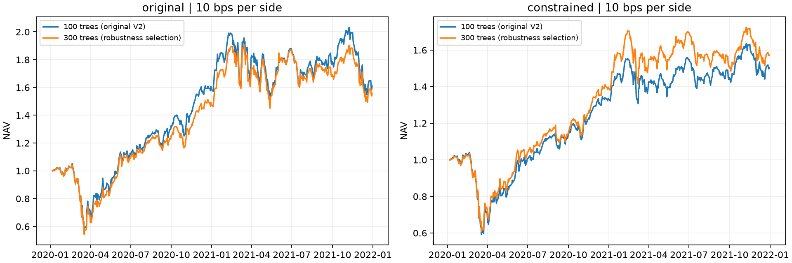

# 参数稳健性入选配置：2020–2021 组合回测

**原有 21 特征 LightGBM 从 100 棵树增加到 300 棵树后，风险约束组合净 CAGR 从 22.81% 提高到 25.58%，前 10% 等权组合却从 27.07% 降到 24.98%。改善依赖组合构造，主要集中在风险约束组合的 2020 年；配对净收益差的置信区间仍包含零。**

本轮复用[参数稳健性实验](../parameter_robustness_v2/README.md)保存的第二窗口预测，模型均使用 2015–2019 训练。没有重新拟合、最终拟合或新生成预测，也没有使用 2022–2025 表现。原 V2 结果、最终模型与主模型身份保持不变。

## 回测口径

- 六组入选配置各做前 10% 等权、风险约束组合；额外回放原有 LightGBM 的 100 棵树版本，两种组合合计 **14 条路径**。
- 信号每五个交易日形成，下一交易日收盘执行。沿用原完整信号区间：2020-01-06 为初始净值日，2021-12-30 为最后清算日，100 次调仓、501 个收益日。
- 买卖各 **10 bps**；普通卖款按最终资金规则可用于买入，买卖应收应付按历史结算日历核算，继续核对未来结算资金，无融资。公司行动沿用核验后的现金、换股与 lag 2 到账/处置规则。
- 风险组合在全体合格股票中最大化当日预测百分位分数，目标满仓；单股 ≤2%，SIC 两位行业相对股票池等权偏离 ≤2 个百分点，beta 偏离 ≤0.10，个股年化波动率加权均值 ≤股票池均值+0.10。后一项不是组合协方差波动率约束。
- 沿用原风险缺失填补与交易失败处理；不增加换手惩罚，不按本轮收益更换参数或组合规则。
- 参数仍按两个开发窗口等权 Rank IC 选择。相同的 2020–2021 已参与选参，因此本表属于开发期评价，不是新增独立测试。

冻结记录：[frozen_backtest.json](frozen_backtest.json)。原 V2 对照分别来自[第二轮回归](../context_selection_v2/README.md)与[第三轮排序](../ranking_selection_v2/README.md)的相同验证期。

## 六组模型的统一比较

所有数值均为扣费 CAGR。21 表示原有特征，33 表示加入市场、行业背景特征；LightGBM 回归与排序是不同目标。

| 设计 | 原前 10% 等权 | 本轮前 10% 等权 | 原风险约束 | 本轮风险约束 |
|---|---:|---:|---:|---:|
| Ridge 21 | 16.13% | 16.13% | 18.69% | 18.69% |
| Ridge 33 | 4.41% | 4.41% | 20.55% | 20.55% |
| LightGBM 回归 21 | 27.07% | **24.98%** | 22.81% | **25.58%** |
| LightGBM 回归 33 | 25.63% | 25.63% | 11.67% | 11.67% |
| LightGBM 排序 21 | 12.31% | 12.31% | 15.85% | 15.85% |
| LightGBM 排序 33 | 35.53% | 35.53% | 31.98% | 31.98% |

五组没有更换候选，净值完全复现。唯一变化为原有特征回归 LightGBM 的 L00→L06：叶数 7、最小叶样本数 500 保持不变，树数 100→300。增强排序在此验证期的 CAGR 仍最高；本轮不据此改选原先按 IC 冻结的主模型。

## 300 棵树是否改善净收益

| 指标 | 前 10%：100 树 | 前 10%：300 树 | 风险约束：100 树 | 风险约束：300 树 |
|---|---:|---:|---:|---:|
| 净 CAGR | 27.07% | 24.98% | 22.81% | 25.58% |
| 年化波动率 | 45.60% | 43.77% | 33.79% | 33.42% |
| Sharpe（无风险利率 0） | 0.754 | 0.729 | 0.779 | 0.850 |
| 最大回撤 | −47.06% | −47.98% | −43.11% | −41.04% |
| 平均调仓换手 | 53.30% | 54.24% | 65.05% | 63.24% |
| 年化直接费用率 | 5.41% | 5.51% | 6.59% | 6.41% |
| 相对股票池等权的年化日均净收益差 | +8.35% | +5.91% | +0.31% | +2.39% |
| 信息比率 | 0.355 | 0.269 | 0.029 | 0.224 |

换手为 `(买入额 + 卖出额) / (2 × 交易前净值)`，取调仓日均值；年化直接费用率为 `252 × mean(当日费用 / 交易前净值)`，不是零费用反事实与净 CAGR 的差。完整字段见 [comparison.csv](comparison.csv)。

风险约束下，300 树净 CAGR 提高 **2.76 个百分点**，波动略降，最大回撤收窄 **2.07 个百分点**。换手下降 1.82 个百分点，年化直接费用率下降 **0.18 个百分点**，费用节省有帮助，但不足以单独解释全部增量。

前 10% 等权下，净 CAGR 下降 **2.09 个百分点**，换手略升，年化直接费用率增加约 **0.09 个百分点**。因此收益下降也不能主要归结于成本变化。



## 差异主要来自哪一年

| 组合 | 年份 | 100 树净收益 | 300 树净收益 | 差值 |
|---|---|---:|---:|---:|
| 前 10% 等权 | 2020 | 58.54% | 47.55% | **−10.99pp** |
| 前 10% 等权 | 2021 | 1.56% | 5.58% | +4.02pp |
| 风险约束 | 2020 | 33.33% | 39.19% | **+5.86pp** |
| 风险约束 | 2021 | 12.85% | 12.99% | +0.14pp |

风险约束组合的改善主要来自 2020。月度比较中，2020 年 3 月少亏 **3.26pp**，11 月多赚 **2.03pp**；6 月和 9 月分别落后 2.18pp、2.72pp。2021 年 1 月与 4 月虽分别领先 3.88pp、2.30pp，后续部分月份回吐，全年仅小幅改善。月度差不能直接相加作为全年复利差。

前 10% 等权的 2020 年则在 3 月、4 月、9 月分别落后约 3.64pp、2.01pp、2.87pp。月度明细见 [lightgbm_monthly.csv](lightgbm_monthly.csv)，年度明细见 [annual_comparison.csv](annual_comparison.csv)。

## 为什么 IC 提高，两种组合却出现相反结果

验证期 Rank IC 从 **0.00547 提高到 0.00840**，但此前候选评价中的顶部平均五日超额标签从 **37.67 bps 降至 32.62 bps**。全截面排序改善并不保证最前面的 10% 股票也改善，本次等权回测与这一诊断方向一致。标签与真实组合仍存在执行时点、费用及资金处理差异，不能直接换算。

风险优化器使用全股票池分数，再受行业、beta 与波动约束形成权重。它与直接取前 10% 的持仓不同，因此能从同一次排序变化中得到不同结果。已执行持仓的平均 beta 中，前 10% 组合由 **1.761 降到 1.628**；风险组合由 **1.202 变为 1.198**。前者的风格变化明显，后者更接近相同风险范围；这支持分别比较两种组合，尚不能将收益增量归因于某一个因子。

全部 **700 个目标快照**通过独立约束核验。交易后权重受费用、不能买入的证券、继承持仓及应收款影响，不能声称每天严格满足目标约束。300 树风险组合调仓后的最大单股权重为 2.0031%，最大行业偏离 2.2291pp，最大 beta 偏离 0.100386；已覆盖股票权重最低 96.06%。覆盖率指当前合格股票池内已持有证券价值占净值的比例，不是数据行覆盖率。

300 树两种组合均在 2021-04-15 出现一次部分计划买入因不可买状态而未成交，金额分别为初始本金单位的 0.03334、0.03002；原 100 树未出现。这些执行差异已按原规则进入净值，没有补成交或事后调整规则。目标与执行暴露见 [exposure_summary.csv](exposure_summary.csv)。

## 不确定性与研究结论

在同一交易日对齐“300 树减 100 树”的净收益，使用原定 **20 交易日循环区块、2,000 次重采样、seed=20261107**。主指标为年化日均净收益差；减去同一等权基准后差值相同。

| 组合 | 年化日均净收益差 | 95% 区间 |
|---|---:|---:|
| 前 10% 等权 | −2.44pp | [−12.81pp, +8.06pp] |
| 风险约束 | +2.09pp | [−6.02pp, +9.74pp] |

这里不是 CAGR 差的置信区间。两者都包含零，且没有校正反复使用开发数据、模型选择和多重比较。其他五组的新旧模型相同，配对差为零反映相同预测与持仓，并不表示它们的收益没有不确定性。

本轮可以确认：**增加到 300 棵树，在既定风险约束组合中带来了更好的验证期收益风险点估计；它没有带来跨组合构造的普遍改善，也未形成稳定增益的统计证据。** 扩大参数网格只改变一组候选，仍未推翻“模型分数、组合约束与时期共同决定可交易效果”的项目结论。

本轮保留原冻结主模型、原最终模型及全部历史结果。没有启动最终拟合或历史测试回放。

## 运行与核验

```powershell
python scripts/backtest.py robustness-validation
python -m pytest -q tests/test_robustness_validation.py tests/test_risk_comparison.py tests/test_robustness_validation_artifacts.py
```

入口要求本地已有参数稳健性预测、开发期风险快照、CRSP 数据和核验后的资金/公司行动材料；不联网下载，也不自动训练。输出目录已存在时停止，保护本轮结果。个股持仓、成交与事件明细保存在忽略的 `outputs/robustness_validation_backtest_v2/`，公开目录仅保存组合汇总。

- 10 项合成/引擎测试与 3 项真实产物只读核验通过。
- 14 条路径、7,028 个组合日资金账本核验通过；全部数据日期位于 2020–2021。
- 五组未变化模型的 10 条路径与旧 100 树的两条路径均复现，最大净值误差为零。
- 选中预测、拟合账本、风险快照与比较输入哈希保持不变；既有 1,478 个输出文件大小及修改时间保持不变。
- 0 次模型拟合、0 次最终拟合、0 次预测调用、0 次 2022–2025 表现读取。

完整记录：[verification.json](verification.json)、[reproduced_paths.csv](reproduced_paths.csv)、[paired_intervals.csv](paired_intervals.csv)。
