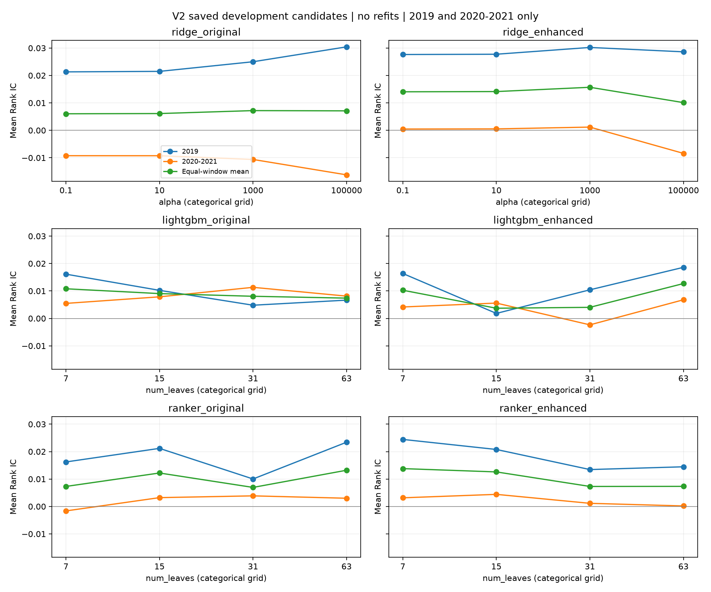

# V2 参数搜索充分性审计

本次只读取第二、三轮已保存的开发期候选汇总：2015–2018→2019、2015–2019→2020–2021。没有训练、预测或回测，没有读取 2022–2025 行情或表现，也没有修改冻结参数、主模型身份及原结果。

**判断：现有网格足以完成一次小预算方案比较，但不足以说明模型已充分调优。值得保留一轮有针对性的参数稳健性扩展，优先检查 LightGBM 的搜索维度和边界；不建议直接为每组补足 20 个候选。跨窗口偏好反转，比候选数量本身更突出。** 本次仅提出方向，未新增实验预算或执行拟合。

## 数据与方法

- 六种设计、每种四个候选、两个窗口，共 48 条候选窗口记录、24 种参数配置。候选 IC 是各窗口内逐信号日平均值。
- 窗口 1 为 49 个信号日、24,427 条合格样本；窗口 2 为 100 个信号日、49,860 条合格样本。沿用冻结规则，两个窗口各占一半，不按日期数或行数合并加权。
- 独立复算全部 24 个平均 IC，与保存的 candidate_ranking.csv 一致。参数边界按既定网格最小/最大值判断；各窗口单独最优仅用于诊断，不重新选参。
- 同参数对照覆盖三种模型的“增强减原有”，以及两种特征下的“排序减回归”，共 20 个配对。固定叶数对照消除入选叶数不同这一混杂；排序对照仍同时改变损失与标签离散化。
- 这里只使用汇总均值。候选差距和四个候选之间的排名相关都是描述性统计，没有候选配对日序列的重采样区间，不能解释为显著性或最优参数的确定性证据。

## 1. 最优参数与窗口稳定性

IC 均以原始小数表示。领先幅度是两窗口等权 IC 第一名减第二名；窗口排名相关是四个候选的 Spearman 相关，不是股票横截面 Rank IC。

| 设计 | 等权入选参数 | 位置 | 2019 单独最优 | 2020–2021 单独最优 | 等权 IC | 领先第二名 | 窗口候选排名相关 |
|---|---:|---|---:|---:|---:|---:|---:|
| Ridge 21 | 1,000 | 内部 | 100,000 | 0.1 | 0.007196 | 0.000091 | −1.0 |
| Ridge 33 | 1,000 | 内部 | 1,000 | 1,000 | 0.015699 | 0.001563 | +0.4 |
| 回归 LightGBM 21 | 7 | 下边界 | 7 | 31 | 0.010799 | 0.001754 | −1.0 |
| 回归 LightGBM 33 | 63 | 上边界 | 63 | 63 | 0.012703 | 0.002434 | +0.4 |
| 排序 LightGBM 21 | 63 | 上边界 | 63 | 31 | 0.013207 | 0.001010 | −0.4 |
| 排序 LightGBM 33 | 7 | 下边界 | 7 | 15 | 0.013796 | 0.001204 | +0.6 |

只有增强 Ridge、增强回归 LightGBM 的两个窗口单独最优与等权选择完全一致。四组树模型均在边界，但曲线形状不支持一律向边界外扩张。

**Ridge 21：内部最优并不代表搜索已充分。** alpha 从 0.1 增至 100,000，2019 IC 从 0.021315 升至 0.030431，2020–2021 则从 −0.009241 降至 −0.016222。两个窗口完全相反；alpha=1,000 比 100,000 只领先 0.000091。当前入选值更像两个时期取舍后的点估计，不能称为清晰的最佳正则化强度。四种 alpha 在第二窗口都为负，现有网格内调参没有消除失效。

**Ridge 33：局部加密比继续拓宽数量级更有依据。** 两窗口均选 alpha=1,000，alpha=100,000 在第二窗口下降至 −0.008395。可在未来独立实验中检查 1,000 附近的敏感性，并对两种特征共用网格；当前曲线没有提供优先向更强正则化外扩的理由。

**回归 LightGBM 21：下边界赢家伴随完全相反的窗口排序。** 2019 偏好 7 叶，2020–2021 偏好 31 叶。等权 IC 随 7/15/31/63 叶依次为 0.010799/0.009045/0.008066/0.007391。更小树可以作为复杂度稳健性检查，但不能预计它会同时改善两个窗口。

**回归 LightGBM 33：最值得检查上边界。** 两窗口均选 63 叶，这是四组树模型中较一致的边界证据。不过中间的 15/31 叶表现较差，曲线并非平滑单调；不能按“越大越好”外推。未来应同时评估树数、叶节点最小样本数，而不只增加一个更大的叶数。

**排序 LightGBM 21：63 叶主要得到 2019 支持。** 相对 15 叶，63 叶在 2019 的 IC 高 0.002242，在第二窗口低 0.000222，平均只高 0.001010；31 叶的等权 IC 反而较低。边界入选不足以证明更大树更好。

**排序 LightGBM 33：优先检查小树附近。** 7 叶在 2019 最好，15 叶在第二窗口最好；两者等权 IC 差 0.001204，31/63 叶均明显低于它们。未来的小规模复杂度对照比全面增加大树候选更贴合现有证据。



横轴是四个离散候选位置，连线仅帮助阅读，不表示已经观测了相邻参数之间的性能。完整 24 行数据见 [candidate_curves.csv](candidate_curves.csv)。

## 2. 同参数下：新增背景特征是否有效

下表均为增强减原有的 IC 差。

| 模型 | 参数 | 2019 差 | 2020–2021 差 | 两窗口等权差 |
|---|---:|---:|---:|---:|
| Ridge | 0.1 | +0.006320 | +0.009713 | +0.008017 |
| Ridge | 10 | +0.006249 | +0.009779 | +0.008014 |
| Ridge | 1,000 | +0.005211 | +0.011795 | +0.008503 |
| Ridge | 100,000 | −0.001812 | +0.007827 | +0.003008 |
| 回归 LightGBM | 7 | +0.000246 | −0.001304 | −0.000529 |
| 回归 LightGBM | 15 | −0.008405 | −0.002277 | −0.005341 |
| 回归 LightGBM | 31 | +0.005617 | −0.013676 | −0.004030 |
| 回归 LightGBM | 63 | +0.011958 | −0.001334 | +0.005312 |
| 排序 LightGBM | 7 | +0.008213 | +0.004777 | +0.006495 |
| 排序 LightGBM | 15 | −0.000404 | +0.001194 | +0.000395 |
| 排序 LightGBM | 31 | +0.003433 | −0.002719 | +0.000357 |
| 排序 LightGBM | 63 | −0.008958 | −0.002806 | −0.005882 |

**Ridge 的特征增量最一致。** 四组等权差均正，前三个 alpha 在两个窗口都改善，说明改善并非只来自挑中了一个 alpha。仍然是开发期描述性证据。

**回归 LightGBM 的特征增量依赖树规模与时期。** 四种叶数在第二窗口全部变差；唯一等权改善的 63 叶，也完全由 2019 的改善抵消第二窗口下降。比较“各自最优”的 7 叶原有版与 63 叶增强版，会掩盖这一事实。

**排序模型在小树下更能利用背景。** 7 叶是唯一两窗口均改善的特征对照；63 叶则两窗口均下降。15/31 叶的小幅正等权差都包含窗口方向反转。

## 3. 同叶数下：排序目标是否优于回归

下表为排序减回归的 IC 差；两者使用相同特征方案和叶数。

| 特征 | 叶数 | 2019 差 | 2020–2021 差 | 两窗口等权差 |
|---|---:|---:|---:|---:|
| 原有 21 | 7 | +0.000098 | −0.007093 | −0.003498 |
| 原有 21 | 15 | +0.010950 | −0.004646 | +0.003152 |
| 原有 21 | 31 | +0.005212 | −0.007461 | −0.001124 |
| 原有 21 | 63 | +0.016760 | −0.005128 | +0.005816 |
| 增强 33 | 7 | +0.008065 | −0.001012 | +0.003527 |
| 增强 33 | 15 | +0.018952 | −0.001176 | +0.008888 |
| 增强 33 | 31 | +0.003028 | +0.003496 | +0.003262 |
| 增强 33 | 63 | −0.004156 | −0.006600 | −0.005378 |

**原有特征下，排序在四种叶数上都改善 2019、降低 2020–2021。** 调整现有叶数并没有找到两个窗口都优于回归的组合。

**增强特征下，只有 31 叶的排序减回归差在两个窗口均正。** 但增强排序 31 叶自身等权 IC 为 0.007298，明显低于入选 7 叶的 0.013796；相对弱对照的稳定改善不等于绝对预测能力最好。不能因此将最终模型改选为 31 叶。63 叶的排序在两个窗口均落后于回归。

## 4. 是否需要扩大网格

若目标是交付当前求职项目，现有结果足以展示受控研究，但应将结论限定为“小预算冻结设置下的比较”。若目标是进一步判断模型设计是否充分发挥能力，建议另立一轮参数稳健性实验：

1. **优先补 LightGBM 的搜索维度。** 当前固定 100 棵树、min_child_samples=500，没有证据证明这两个值对回归和排序都充分。未来可共同考察训练轮数与正则化强度，同时保留现有候选作锚点。等预算并不自动代表不同模型得到同等充分的调优。
2. **按曲线有针对性地检查边界。** 增强回归 63 叶的上边界证据最一致；增强排序重点关注 7/15 叶附近。原有回归和排序的窗口冲突应单独报告，避免将不同窗口的偏好合并成“继续扩大就会更好”。对照组仍需使用相同参数集合，以保留同参数归因。
3. **Ridge 做局部敏感性优先于拓宽极值。** 检查 1,000 附近、两种特征共用候选；保留原始网格参照。原有版第二窗口全负和接近打平的等权最优需要继续披露。
4. **先冻结新预算与选择规则。** 仍只用开发窗口选参；逐窗口完整报告，不因本次观察事后改变窗口权重。已有 2022–2025 不能充当新一轮独立确认数据，也不得用于决定参数范围或挑选赢家。

本次审计不能估计扩大网格后能提升多少 IC，也不能证明固定树数导致欠拟合：现有汇总未包含对这些设置的候选扫描。新增实验的合理目的应是检查结论对训练设置是否敏感，而不是追逐某个历史回报。

## 复核与复现

```powershell
python scripts/evaluate.py search-audit-v2
python -m pytest -q tests/test_search_audit_v2.py
```

入口仅允许读取两个开发目录下的 candidate_metrics.csv / candidate_ranking.csv。重跑只更新本目录的派生 CSV、曲线和审计 JSON，不写模型、预测或已有研究结果。

- [完整候选曲线](candidate_curves.csv)
- [边界、领先幅度与窗口偏好](search_summary.csv)
- [20 组同参数对照](matched_contrasts.csv)
- [输入哈希与执行审计](audit.json)

原参数源：[背景特征设计](../../docs/CONTEXT_FEATURES_V2.md)、[排序设计](../../docs/RANKING_V2.md)。所有源候选文件在分析前后哈希一致。
