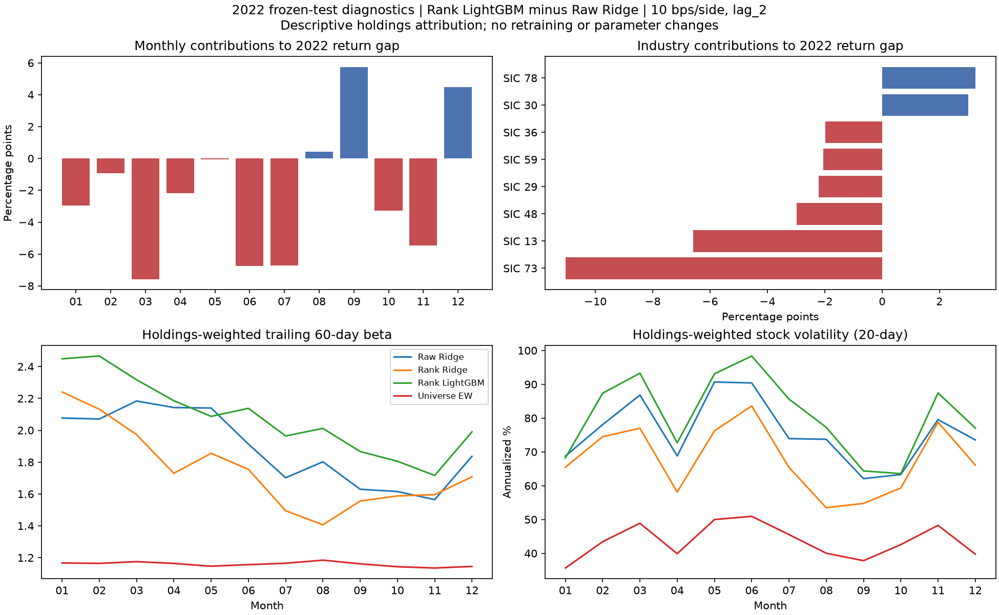

# 测试后的持仓归因：Ridge 与排名 LightGBM

使用已保存的 2022–2025 年预测、持仓和交易记录，沿用单边 10 bps 成本、`lag_2` 公司行动到账及原资金结算规则。没有重新训练、调参、生成预测或重跑组合。六组组合均纳入分析，以下重点比较两组 Ridge 与排名 LightGBM。

| 2022 年 | 原始 Ridge | 排名 Ridge | 排名 LightGBM | 股票池等权 |
|---|---:|---:|---:|---:|
| 净收益 | −11.73% | −12.08% | −37.06% | −16.75% |
| 持仓加权历史 beta | 1.886 | 1.740 | 2.074 | 1.159 |
| 持仓股票历史波动率 | 76.03% | 67.73% | 80.98% | 43.74% |
| 持仓几何市值（十亿美元） | 12.93 | 14.88 | 13.45 | 30.55 |
| 平均 Rank IC | 0.0407 | 0.0423 | 0.0098 | — |

beta 为持仓股票过去 60 日相对 CRSP 市场的 beta 加权平均；波动率为各股票过去 20 日年化波动率的加权平均，不是组合实现波动率。市值先按持仓权重平均对数市值，再跨日平均取指数。暴露均使用归因日前已知的信息。

排名 LightGBM 的风险暴露更高，但原始 Ridge 的持仓市值还略小，不能用“大盘股保护了 Ridge”解释结果。三组模型相对股票池等权都有明显风险倾向。

## 差距集中在哪里

2022 年排名 LightGBM 比原始 Ridge 落后 **25.33 个百分点**。实际持仓的行业净损益贡献如下，均以各组合年初净值为分母：

| SIC 行业 | 原始 Ridge 贡献（pp） | 排名 LightGBM 贡献（pp） | 差值（pp） |
|---|---:|---:|---:|
| 73 商业服务（含软件） | +5.54 | −5.50 | −11.04 |
| 13 油气开采 | +11.02 | +4.44 | −6.59 |
| 48 通信 | +0.48 | −2.50 | −2.98 |
| 36 电子电气设备 | −2.59 | −4.57 | −1.99 |

商业服务和油气两项合计差值 −17.63 pp，约占净差距的 69.6%。这是损益来源的分解比例，不是因果解释比例。油气平均权重分别为原始 Ridge 5.98%、排名 LightGBM 6.50%；后者配置并不少，却获得更少贡献，说明需要同时考虑行业内选股、持有时段和资金路径。

3、6、7、11 月分别使排名 LightGBM 相对原始 Ridge 的全年贡献差扩大 7.57、6.76、6.72、5.47 pp。差距既来自下跌月份，也来自反弹月份获利较少：3 月两者当月收益分别为 12.27%、4.29%；6 月为 −0.99%、−10.74%；7 月为 19.92%、15.74%。月度收益以月初净值为分母，需要复利连乘；年初净值口径的月度贡献才可以相加。

费用并非 LightGBM 落后的原因。实际资金路径下，原始 Ridge 的全年费用贡献为 −6.96 pp，排名 LightGBM 为 −3.45 pp；成本反而缩小了后者的落后幅度。这不是另跑零成本组合得到的结果。

## 结论与适用范围

现有证据支持：这套特征、训练期与交易规则下，排名 LightGBM 的验证优势未延续到冻结测试期；2022 年更高风险暴露、较弱 Rank IC 与关键行业的持仓损益差异同时出现。不能据此推断 LightGBM 普遍不如 Ridge，或全部差距都由 beta 导致。

排名 LightGBM 保留测试前指定主模型的身份。本次属于测试后的描述性分析；若据此修改风险约束或模型，需要新增未见数据评估。行业采用历史有效 SIC 分类，不是 GICS，也不是未修订的当年发布版本；贡献包含行业配置、行业内选股、持有时段及费用，尚未做正式因果因子分解。

核验：5982 个组合日、24 个模型年度、行业与个股各 288 个模型月对账通过。2022 年三组重点模型的风格覆盖率均为 100%，未知行业权重为 0。原始产物哈希保持一致，191 项自动化测试通过。

这里仅发布组合与行业级汇总。个股持仓、交易和归因明细保留在本地。具有原研究产物时，运行 `python scripts/evaluate.py test-exposures` 生成完整明细；已完成输出目录拒绝覆盖。

公开表格：[年度暴露](yearly_exposures.csv)、[月度收益与贡献](monthly_returns.csv)、[月度行业贡献](monthly_industry_contributions.csv)、[模型评分与风格相关性](score_style_correlations.csv)。
